# Kodeguide: sådan virker løsningen, og hvorfor

Læs filerne i den rækkefølge, de står her. Hver fil kan forklares på et minut.
Alle kodelinjer er også kommenteret på dansk direkte i filerne.
Billederne herunder er taget af den rigtige kode med de rigtige linjenumre.

## 0. Hele repoet (treeview)

```
Delopgave2/
├── .github/
│   └── workflows/
│       └── ci.yml                       CI/CD: pip-audit → pytest → Docker → Newman
├── docs/
│   ├── img/
│   │   ├── 01-rules.png … 11-ci.png      kodeskærmbillederne i denne guide
│   │   ├── diagram-simpel-1…6-*.png     arkitektur, alarmflow, sekvens, CI/CD, datamodel, vejen frem
│   │   └── README.md                    oversigt over diagrammerne
│   ├── KODEGUIDE.md                     denne fil
│   ├── KRAV.md                          opgavens krav → hvor de er løst
│   ├── PI-GUIDE.md                      sådan startes pi.py på Raspberry Pi'en
│   └── VIDEOMANUSKRIPT.md               manuskript til videoen (ca. 5 min)
├── pi/
│   └── pi.py                            kører på Pi'en: måler, sender, farver LED'en
├── postman/
│   └── fugt-mvp.postman_collection.json 5 Postman-kald, der gennemspiller alarmflowet
├── static/
│   └── index.html                       kontrolcentret (HTML + CSS + JavaScript i én fil)
├── tests/
│   └── test_mvp.py                      de 5 pytest-tests
├── .dockerignore                        filer, der ikke kommer med i Docker-imaget
├── .gitignore                           filer, git ignorerer
├── Dockerfile                           opskriften på API'ets container
├── README.md                            forsiden på GitHub: kom i gang + endpoints
├── db.py                                databasen: tabellerne measurement og alarm
├── docker-compose.yml                   starter API + PostgreSQL som to containere
├── main.py                              REST API'et (FastAPI): de 4 endpoints
├── pytest.ini                           fortæller pytest, hvor koden ligger
├── requirements-dev.txt                 pakker kun til test
├── requirements.txt                     pakker til serveren
└── rules.py                             domænereglerne: grøn/gul/rød + åbn/luk alarm
```

Kun tre filer udgør selve serveren: `main.py`, `rules.py` og `db.py`.

## 1. Den store tegning

```
Pi (pi.py)  --POST fugt-->  API (main.py)  --spørger-->  regler (rules.py)
     ^                          |
     |  svar: green/yellow/red  +--gemmer-->  PostgreSQL (db.py: measurement + alarm)
     +--------------------------+
Browser (index.html) --GET målinger/alarmer, POST kvittering--> API
```

Kun serveren træffer beslutninger. Pi'en og browseren viser bare, hvad serveren har sagt.

| Opgavens krav | Hvor i koden |
|---|---|
| Event: *Sensor Value Received* | `POST /measurements` (billede 3) → tabellen `measurement` (billede 5) |
| Beslutning: threshold-check | `rules.status()` (billede 1) |
| Event: *Anomaly Detected* → alarm | `rules.should_open_alarm()` → tabellen `alarm` |
| Validering | `MeasurementIn` (billede 2) |
| Separat database | PostgreSQL i egen container (billede 9) |
| Docker | `Dockerfile` + `docker-compose.yml` (billede 9–10) |
| CI/CD | `.github/workflows/ci.yml` (billede 11) |
| Tilgås fra IoT-enhed | `pi/pi.py` (billede 6) + `--host 0.0.0.0` (billede 10) |

### Fra delopgave 1 til koden: bounded contexts (rapportens afsnit 2)

Event Storming i delopgave 1 gav fire *faser* (Device, Håndtering, Service case, Execution). En fase siger kun,
*hvornår* noget sker. En **bounded context** er et område med eget ansvar og eget sprog. Vi har gjort faserne til
fire contexts (figur 1 i rapporten, `docs/img/diagram-simpel-7-context-map.png`):

| Context (type) | Eget sprog | I koden nu |
|---|---|---|
| Enhed & Måling (core) | enhed, måling, %RH, offline | `pi/pi.py`, `MeasurementIn`, tabellen `measurement` |
| Overvågning & Alarm (core) | grøn/gul/rød, grænse, alarm, kvittering, normal igen | `rules.py`, tabellen `alarm`, `POST /alarms/{id}/ack`, `static/index.html` |
| Servicesag (supporting) | sag, prioritet, SLA | Ikke bygget. Næste skridt: event-bus + Anti-Corruption Layer mod Business Central |
| Feltservice (supporting) | arbejdsordre, tekniker, reservedel | Ikke bygget. Mobile Service App |

**Sådan forklarer du det til eksamen:** "Ordet *alarm* betyder noget forskelligt i de to contexts. Hos os er det en
tilstand med tre tidspunkter (`opened_at`, `acknowledged_at`, `closed_at`). I Servicesag er det bare anledningen til
en sag med en frist. Derfor er de adskilt, og derfor stopper vores MVP ved kvitteringen."

Relationerne (context map): Enhed & Måling → Overvågning & Alarm er *customer/supplier* med et fast JSON-format over
REST (det er `POST /measurements`). Overvågning → Servicesag sker i målbilledet via hændelsen "alarm oprettet" på en
event-bus. Over for Salesforce/Business Central (Kunde & Aftale) er vi *conformist*.

**Teknisk arkitektur og mønstre** (figur 2, `docs/img/diagram-simpel-8-teknisk-arkitektur.png`):
1 REST/API-first (`main.py`) · 2 lagdelt microservice: API-lag `main.py`, domænelag `rules.py`, persistens `db.py` ·
3 database pr. service (PostgreSQL i egen container) · 4 edge gateway: Pi'en beslutter intet · 5 event-driven og
6 Anti-Corruption Layer er målbillede · 7 CI/CD (`ci.yml`).

## 2. `rules.py`: reglen (hjertet)

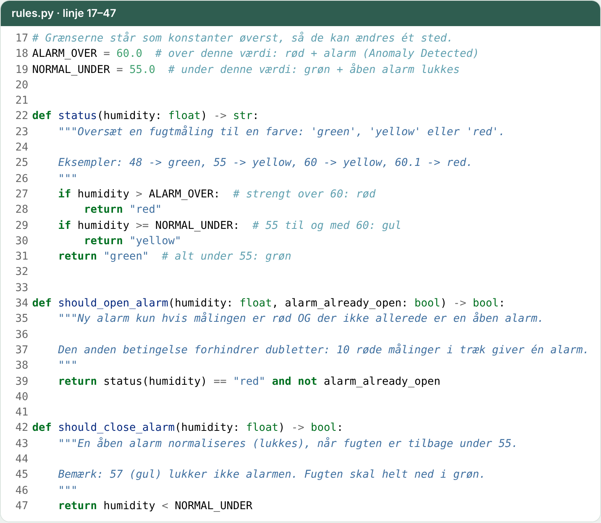

**Hvad:** tre små funktioner. `status()` giver farven, `should_open_alarm()` afgør, om der skal åbnes en alarm, og `should_close_alarm()` afgør, om den skal lukkes.

**Hvorfor sådan:**
- Reglerne er *rene funktioner* uden database og netværk. Derfor kan test 1 tjekke dem på en brøkdel af et sekund, og de kan ændres ét sted.
- Grænserne 55 og 60 står som konstanter øverst, så de ikke er gemt rundt omkring i koden.
- `and not alarm_already_open` forhindrer dubletter: 10 røde målinger giver én alarm, ikke 10.
- Mellemrummet 55–60 er *hysterese*: alarmen lukker først under 55, så den ikke blinker, når fugten vipper omkring 60. Det virker som en termostat.

**Eksamensspørgsmål:** *Hvorfor lukker alarmen ikke ved 59?* Fordi den så ville åbne og lukke hele tiden, hvis fugten svinger mellem 59 og 61.

## 3. `main.py`: API'et

### Validering af input

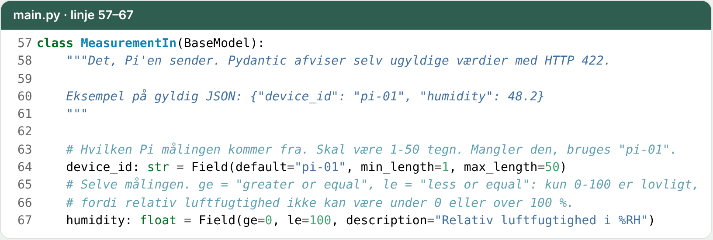

**Hvorfor:** Pydantic tjekker data, før vores kode overhovedet kører. Fugt på 150 eller -5 afvises automatisk med HTTP 422. Så kan reglerne stole på, at tallet er gyldigt. Det er opgavens krav om *validering*.

### Hele event-flowet: `POST /measurements`

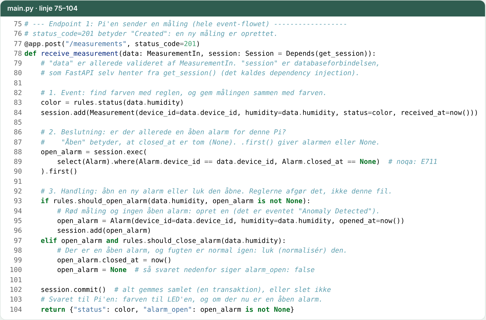

**Hvad:** de tre trin *event → beslutning → handling* står som tre kommentarer i koden.

**Hvorfor sådan:**
- `Depends(get_session)`: FastAPI giver hver forespørgsel sin egen databaseforbindelse. I testene byttes den ud med en testdatabase uden at ændre koden.
- Endpointet *spørger* reglerne i stedet for selv at sammenligne tal. Så ligger domænelogikken ét sted.
- `session.commit()` til sidst gemmer måling og alarm samlet (en *transaktion*): enten bliver alt gemt, eller intet. Der kan ikke opstå en alarm uden den måling, der udløste den.
- Svaret `{"status": "red", "alarm_open": true}` er det, Pi'en bruger til at farve LED'en.

### Kvittering: `POST /alarms/{id}/ack`

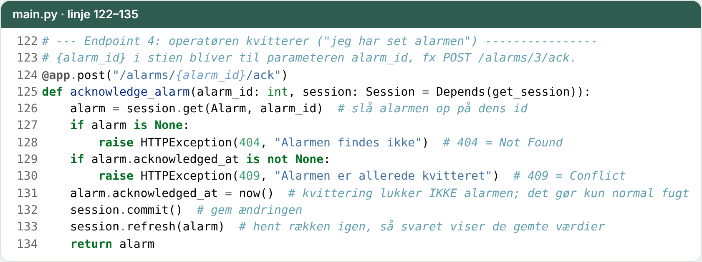

**Hvorfor:** operatøren skal kunne sige "jeg har set den". 404 hvis alarmen ikke findes, 409 hvis den allerede er kvitteret. Kvittering lukker **ikke** alarmen; det gør kun normal fugt. Sådan kan man se forskel på "nogen har set det" og "problemet er væk".

De andre endpoints er korte: `GET /measurements?limit=20` (1–100, ellers 422) og `GET /alarms` henter nyeste først, `GET /` sender kontrolcentret, og `/docs` er Swagger, som FastAPI laver automatisk.

## 4. `db.py`: databasen

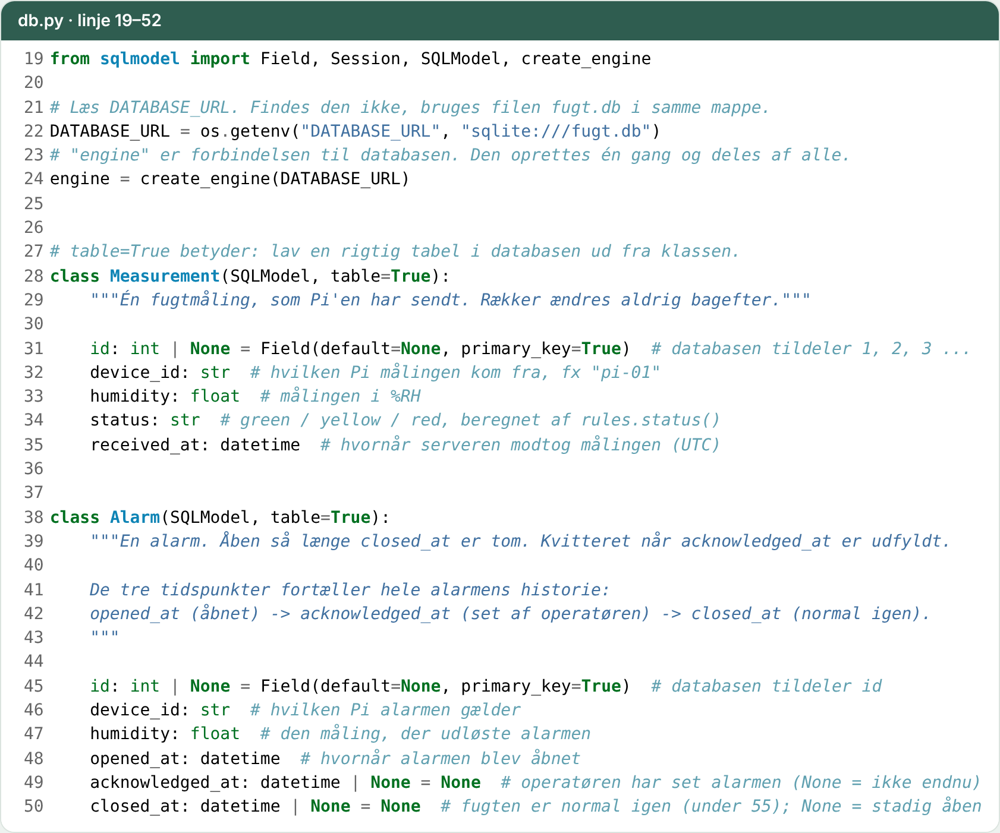

**Hvad:** to tabeller. `Measurement` = én række pr. måling. `Alarm` = én række pr. alarm, med tre tidspunkter: `opened_at`, `acknowledged_at`, `closed_at`.

**Hvorfor sådan:**
- SQLModel: én Python-klasse er både tabellen og objektet i koden. Vi skriver ingen SQL i hånden.
- `DATABASE_URL` fra miljøet: i Docker er det PostgreSQL; uden Docker en SQLite-fil. Samme kode, to databaser.
- Alarmens tilstand læses ud fra, hvilke tidspunkter der er udfyldt. Så behøver vi ikke et ekstra "status"-felt, der kan komme ud af trit.

## 5. `pi/pi.py`: Raspberry Pi'en

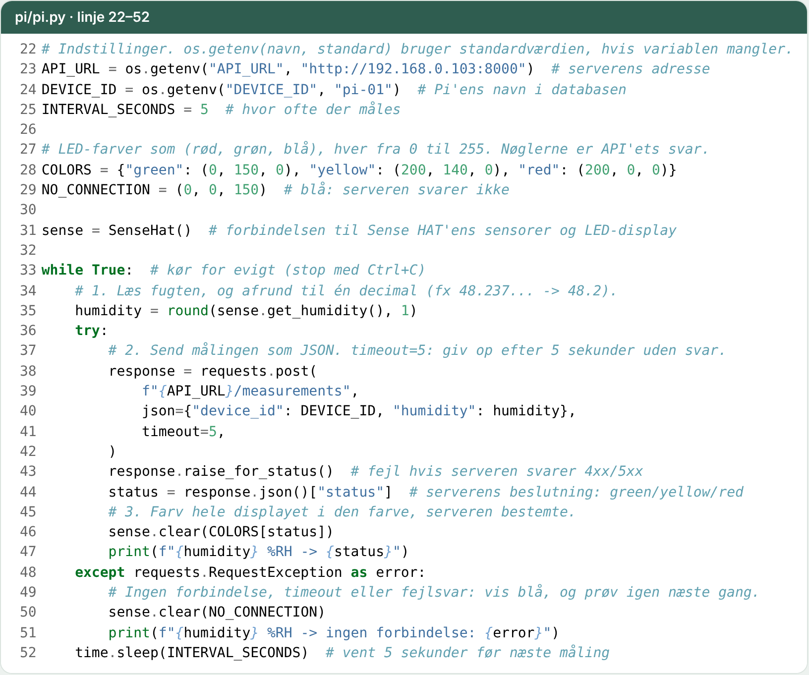

**Hvorfor sådan:**
- Pi'en er "dum": den måler, sender og viser svaret. Reglerne ligger kun på serveren, så de kan ændres uden at røre Pi'en.
- `timeout=5` og `except requests.RequestException`: falder serveren ud, hænger Pi'en ikke. Den viser blå og prøver igen om 5 sekunder (fejlhåndtering).
- `API_URL` sættes med en miljøvariabel, så samme script virker, selv om PC'ens IP skifter.

## 6. `static/index.html`: kontrolcentret

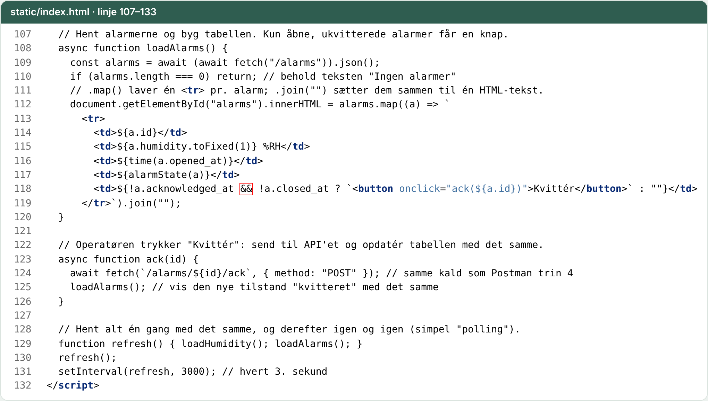

**Hvorfor sådan:**
- Én fil uden framework: det mindste, der viser alarmflowet for operatøren.
- *Polling* med `setInterval(refresh, 3000)`: siden spørger API'et hvert 3. sekund. Simpelt og nok til en MVP.
- Kun åbne, ukvitterede alarmer får en **Kvittér**-knap.
- Lufttryk og rystelser er grå *Fase 2 – mockup*-kort med faste tal og ingen kode bagved. De viser vejen frem uden at bygge den.

## 7. `tests/test_mvp.py`: de 5 tests

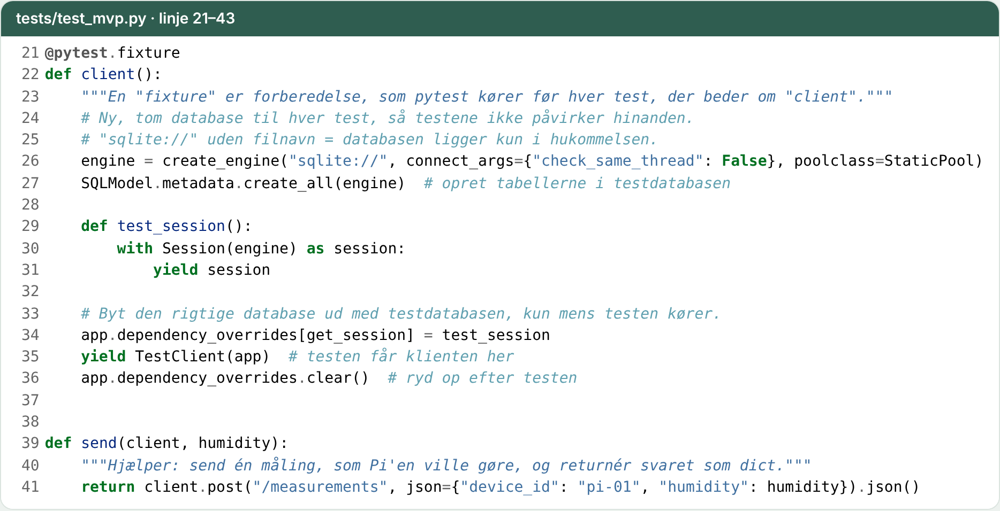

**Hvorfor sådan:** hver test får en ny, tom database i hukommelsen (`sqlite://`). Testene påvirker ikke hinanden og kræver ikke Docker. `dependency_overrides` bytter den rigtige database ud med testdatabasen. Se tabellen *strategi → regel → test* i `KRAV.md`.

## 8. Docker: `docker-compose.yml` og `Dockerfile`

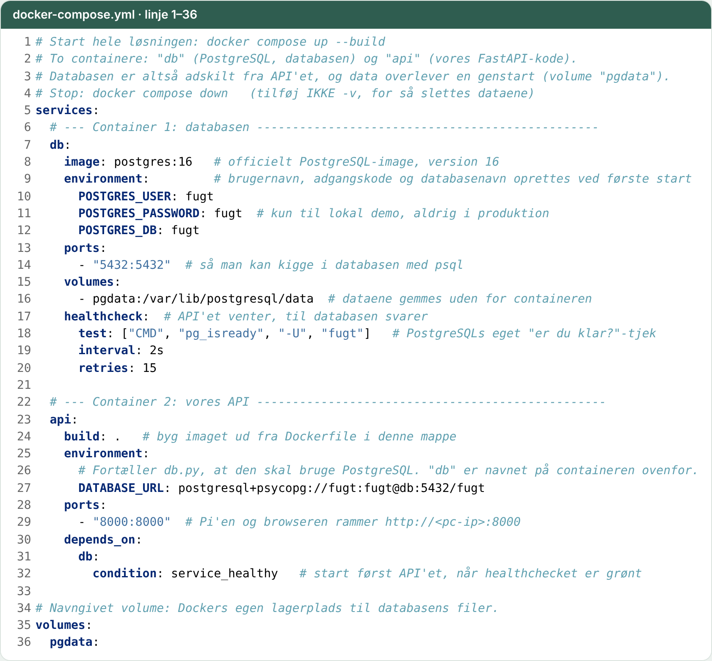

**Hvorfor sådan:**
- To containere: `db` og `api`. Det er opgavens krav om en *separat* database.
- `volumes: pgdata`: data overlever en genstart.
- `healthcheck` + `condition: service_healthy`: API'et starter først, når databasen svarer. Ellers ville `create_tables()` fejle ved opstart.

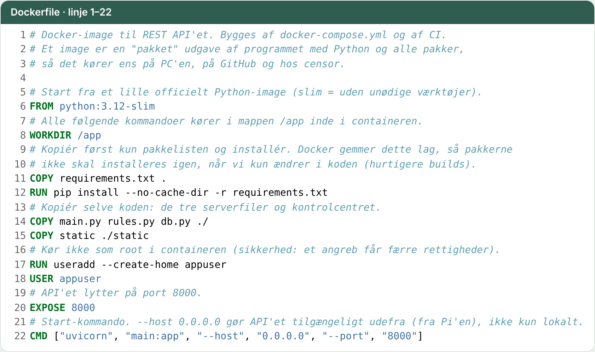

**Hvorfor sådan:**
- `requirements.txt` kopieres før koden, så Docker kan genbruge pakkelaget, når kun koden ændres.
- `USER appuser`: containeren kører ikke som root (sikkerhed).
- `--host 0.0.0.0`: API'et kan nås fra andre maskiner, fx Pi'en, og ikke kun fra PC'en selv.

## 9. CI/CD: `.github/workflows/ci.yml`

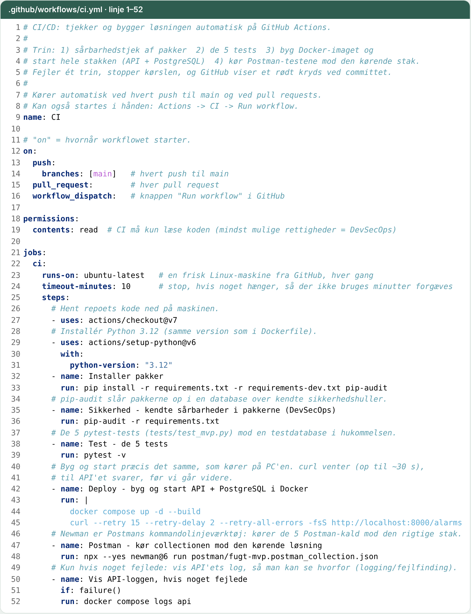

**Hvorfor sådan:** ved hvert push til `main` kører GitHub fire trin. Fejler ét, stopper det hele:

1. **pip-audit**: kendte sikkerhedshuller i pakkerne (DevSecOps).
2. **pytest**: de 5 tests.
3. **Docker**: byg og start præcis den stak, der kører på PC'en.
4. **Newman**: de 5 Postman-kald mod den kørende stak, med rigtig PostgreSQL.

`permissions: contents: read` giver CI mindst mulige rettigheder. Fejler noget, vises API'ets log.

## 10. Hvad er bevidst IKKE med (bare minimum)

Opgaven kræver ikke disse ting, så de er udeladt og nævnt i rapportens refleksion som vejen frem:
login/API-nøgler, migrationer (Alembic), lufttryk og rystelser som rigtige målinger, mørkt tema, deploy til cloud, monitorering ud over loggen.
