# Kodeguide: sådan virker løsningen, og hvorfor

Læs filerne i den rækkefølge, de står her. Hver fil kan forklares på et minut.
Alle kodelinjer er også kommenteret på dansk direkte i filerne.
Billederne herunder er taget af den rigtige kode med de rigtige linjenumre.

## 0. Hele repoet (treeview)

```
Delopgave2/
├── .github/
│   └── workflows/
│       └── ci.yml                       CI/CD: pip-audit → pytest → Docker → Newman → Grafana-tjek
├── grafana/
│   ├── dashboards/
│   │   └── fugt-mvp.json                dashboardet som kode: 9 paneler med SQL mod PostgreSQL
│   └── provisioning/
│       ├── dashboards/dashboards.yml    fortæller Grafana, hvor dashboard-filerne ligger
│       └── datasources/postgres.yml     forbindelsen fra Grafana til databasen "db"
├── docs/
│   ├── img/
│   │   ├── 01-rules.png … 11-ci.png      kodeskærmbillederne i denne guide
│   │   ├── grafana.png                  skærmbillede af Grafana-dashboardet
│   │   ├── diagram-simpel-1…9-*.png     arkitektur, alarmflow, sekvens, CI/CD, datamodel, vejen frem, context map, teknisk arkitektur, dataflow
│   │   └── README.md                    oversigt over diagrammerne
│   ├── KODEGUIDE.md                     denne fil
│   ├── KRAV.md                          opgavens krav → hvor de er løst
│   ├── PI-GUIDE.md                      sådan startes pi.py på Raspberry Pi'en
│   └── VIDEOMANUSKRIPT.md               manuskript til videoen (ca. 5 min)
├── pi/
│   └── pi.py                            kører på Pi'en: måler, sender, farver LED'en
├── postman/
│   └── fugt-mvp.postman_collection.json 5 Postman-kald, der gennemspiller alarmflowet
├── static/
│   └── index.html                       kontrolcentret (HTML + CSS + JavaScript i én fil)
├── tests/
│   └── test_mvp.py                      de 5 pytest-tests
├── .dockerignore                        filer, der ikke kommer med i Docker-imaget
├── .gitignore                           filer, git ignorerer
├── Dockerfile                           opskriften på API'ets container
├── README.md                            forsiden på GitHub: kom i gang + endpoints
├── db.py                                databasen: tabellerne measurement og alarm
├── docker-compose.yml                   starter API + PostgreSQL + Grafana som tre containere
├── main.py                              REST API'et (FastAPI): de 4 endpoints
├── pytest.ini                           fortæller pytest, hvor koden ligger
├── requirements-dev.txt                 pakker kun til test
├── requirements.txt                     pakker til serveren
└── rules.py                             domænereglerne: grøn/gul/rød + åbn/luk alarm
```

Kun tre filer udgør selve serveren: `main.py`, `rules.py` og `db.py`.

## 1. Den store tegning

```
Pi (pi.py)  --POST fugt-->  API (main.py)  --spørger-->  regler (rules.py)
     ^                          |
     |  svar: green/yellow/red  +--gemmer-->  PostgreSQL (db.py: measurement + alarm)
     +--------------------------+
Browser (index.html) --GET målinger/alarmer, POST kvittering--> API
Grafana (port 3000)  --læser (SELECT) direkte fra-->  PostgreSQL
```

Kun serveren træffer beslutninger. Pi'en, browseren og Grafana viser bare, hvad serveren har sagt.

| Opgavens krav | Hvor i koden |
|---|---|
| Event: *Sensor Value Received* | `POST /measurements` (billede 3) → tabellen `measurement` (billede 5) |
| Beslutning: threshold-check | `rules.status()` (billede 1) |
| Event: *Anomaly Detected* → alarm | `rules.should_open_alarm()` → tabellen `alarm` |
| Validering | `MeasurementIn` (billede 2) |
| Separat database | PostgreSQL i egen container (billede 9) |
| Docker | `Dockerfile` + `docker-compose.yml` (billede 9–10) |
| CI/CD | `.github/workflows/ci.yml` (billede 11) |
| Tilgås fra IoT-enhed | `pi/pi.py` (billede 6) + `--host 0.0.0.0` (billede 10) |

### Fra delopgave 1 til koden: bounded contexts (rapportens afsnit 2)

Event Storming i delopgave 1 gav fire *faser* (Device, Håndtering, Service case, Execution). En fase siger kun,
*hvornår* noget sker. En **bounded context** er et område med eget ansvar og eget sprog. Vi har gjort faserne til
fire contexts (figur 1 i rapporten, `docs/img/diagram-simpel-7-context-map.png`):

| Context (type) | Eget sprog | I koden nu |
|---|---|---|
| Enhed & Måling (core) | enhed, måling, %RH, offline | `pi/pi.py`, `MeasurementIn`, tabellen `measurement` |
| Overvågning & Alarm (core) | grøn/gul/rød, grænse, alarm, kvittering, normal igen | `rules.py`, tabellen `alarm`, `POST /alarms/{id}/ack`, `static/index.html` |
| Servicesag (supporting) | sag, prioritet, SLA | Ikke bygget. Næste skridt: event-bus + Anti-Corruption Layer mod Business Central |
| Feltservice (supporting) | arbejdsordre, tekniker, reservedel | Ikke bygget. Mobile Service App |

**Sådan forklarer du det til eksamen:** "Ordet *alarm* betyder noget forskelligt i de to contexts. Hos os er det en
tilstand med tre tidspunkter (`opened_at`, `acknowledged_at`, `closed_at`). I Servicesag er det bare anledningen til
en sag med en frist. Derfor er de adskilt, og derfor stopper vores MVP ved kvitteringen."

Relationerne (context map): Enhed & Måling → Overvågning & Alarm er *customer/supplier* med et fast JSON-format over
REST (det er `POST /measurements`). Overvågning → Servicesag sker i målbilledet via hændelsen "alarm oprettet" på en
event-bus. Over for Salesforce/Business Central (Kunde & Aftale) er vi *conformist*.

**Teknisk arkitektur og mønstre** (figur 2, `docs/img/diagram-simpel-8-teknisk-arkitektur.png`):
1 REST/API-first (`main.py`) · 2 lagdelt microservice: API-lag `main.py`, domænelag `rules.py`, persistens `db.py` ·
3 database pr. service (PostgreSQL i egen container) · 4 edge gateway: Pi'en beslutter intet · 5 event-driven og
6 Anti-Corruption Layer er målbillede · 7 CI/CD (`ci.yml`).

## 2. `rules.py`: reglen (hjertet)

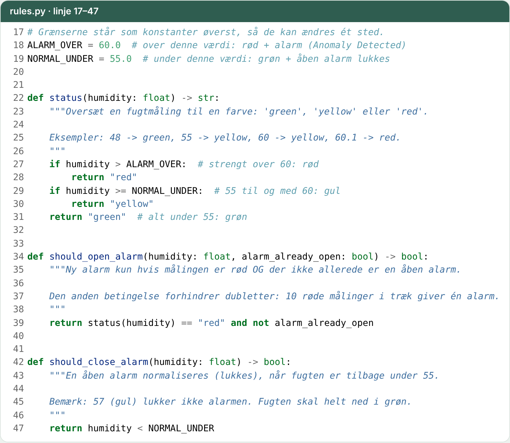

**Hvad:** tre små funktioner. `status()` giver farven, `should_open_alarm()` afgør, om der skal åbnes en alarm, og `should_close_alarm()` afgør, om den skal lukkes.

**Hvorfor sådan:**
- Reglerne er *rene funktioner* uden database og netværk. Derfor kan test 1 tjekke dem på en brøkdel af et sekund, og de kan ændres ét sted.
- Grænserne 55 og 60 står som konstanter øverst, så de ikke er gemt rundt omkring i koden.
- `and not alarm_already_open` forhindrer dubletter: 10 røde målinger giver én alarm, ikke 10.
- Mellemrummet 55–60 er *hysterese*: alarmen lukker først under 55, så den ikke blinker, når fugten vipper omkring 60. Det virker som en termostat.

**Eksamensspørgsmål:** *Hvorfor lukker alarmen ikke ved 59?* Fordi den så ville åbne og lukke hele tiden, hvis fugten svinger mellem 59 og 61.

## 3. `main.py`: API'et

### Validering af input

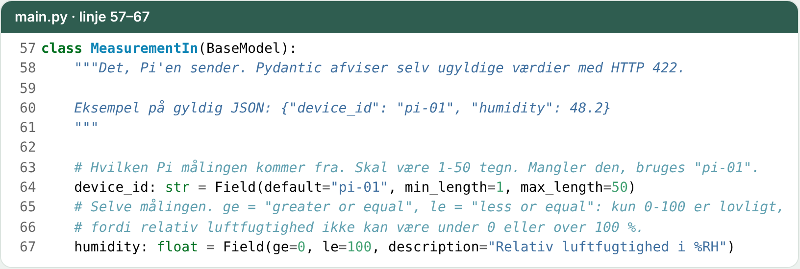

**Hvorfor:** Pydantic tjekker data, før vores kode overhovedet kører. Fugt på 150 eller -5 afvises automatisk med HTTP 422. Så kan reglerne stole på, at tallet er gyldigt. Det er opgavens krav om *validering*.

### Hele event-flowet: `POST /measurements`

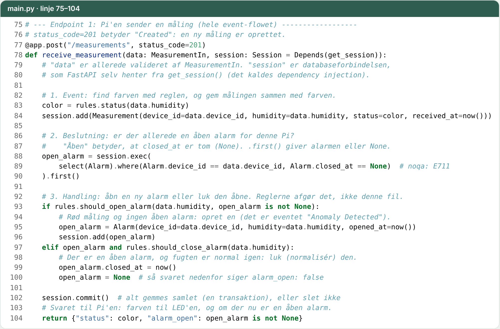

**Hvad:** de tre trin *event → beslutning → handling* står som tre kommentarer i koden.

**Hvorfor sådan:**
- `Depends(get_session)`: FastAPI giver hver forespørgsel sin egen databaseforbindelse. I testene byttes den ud med en testdatabase uden at ændre koden.
- Endpointet *spørger* reglerne i stedet for selv at sammenligne tal. Så ligger domænelogikken ét sted.
- `session.commit()` til sidst gemmer måling og alarm samlet (en *transaktion*): enten bliver alt gemt, eller intet. Der kan ikke opstå en alarm uden den måling, der udløste den.
- Svaret `{"status": "red", "alarm_open": true}` er det, Pi'en bruger til at farve LED'en.

### Kvittering: `POST /alarms/{id}/ack`

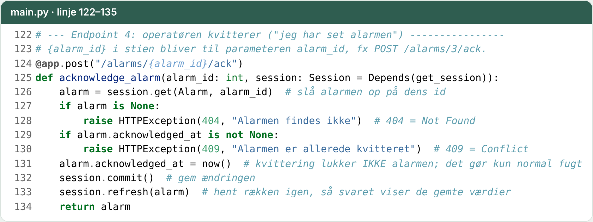

**Hvorfor:** operatøren skal kunne sige "jeg har set den". 404 hvis alarmen ikke findes, 409 hvis den allerede er kvitteret, eller hvis den allerede er lukket (normal igen), for så er der ikke længere noget at kvittere for. Kvittering lukker **ikke** alarmen; det gør kun normal fugt. Sådan kan man se forskel på "nogen har set det" og "problemet er væk".

De andre endpoints er korte: `GET /measurements?limit=20` (1–100, ellers 422) og `GET /alarms` henter nyeste først, `GET /` sender kontrolcentret, og `/docs` er Swagger, som FastAPI laver automatisk.

## 4. `db.py`: databasen

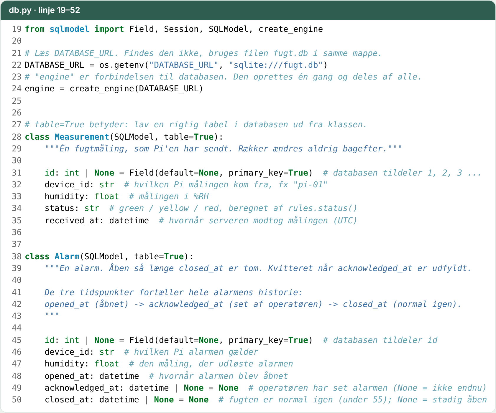

**Hvad:** to tabeller. `Measurement` = én række pr. måling. `Alarm` = én række pr. alarm, med tre tidspunkter: `opened_at`, `acknowledged_at`, `closed_at`.

**Hvorfor sådan:**
- SQLModel: én Python-klasse er både tabellen og objektet i koden. Vi skriver ingen SQL i hånden.
- `DATABASE_URL` fra miljøet: i Docker er det PostgreSQL; uden Docker en SQLite-fil. Samme kode, to databaser.
- Alarmens tilstand læses ud fra, hvilke tidspunkter der er udfyldt. Så behøver vi ikke et ekstra "status"-felt, der kan komme ud af trit.

## 5. `pi/pi.py`: Raspberry Pi'en

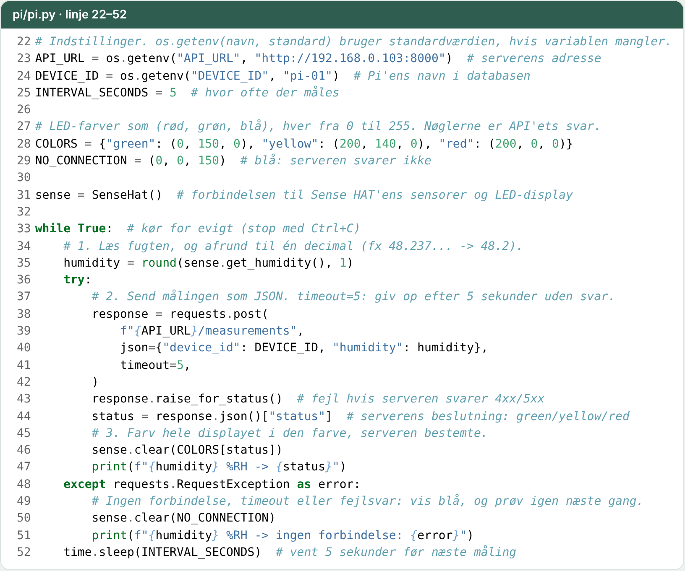

**Hvorfor sådan:**
- Pi'en er "dum": den måler, sender og viser svaret. Reglerne ligger kun på serveren, så de kan ændres uden at røre Pi'en.
- `timeout=5` og `except requests.RequestException`: falder serveren ud, hænger Pi'en ikke. Den viser blå og prøver igen om 5 sekunder (fejlhåndtering).
- `API_URL` sættes med en miljøvariabel, så samme script virker, selv om PC'ens IP skifter.
- `min(..., 100.0)`: Sense HAT'en kan vise lidt over 100 %RH, når man puster direkte på den. API'et godtager kun 0–100, så Pi'en holder værdien på højst 100. Ellers ville et pust give 422 og blå LED.

## 6. `static/index.html`: kontrolcentret

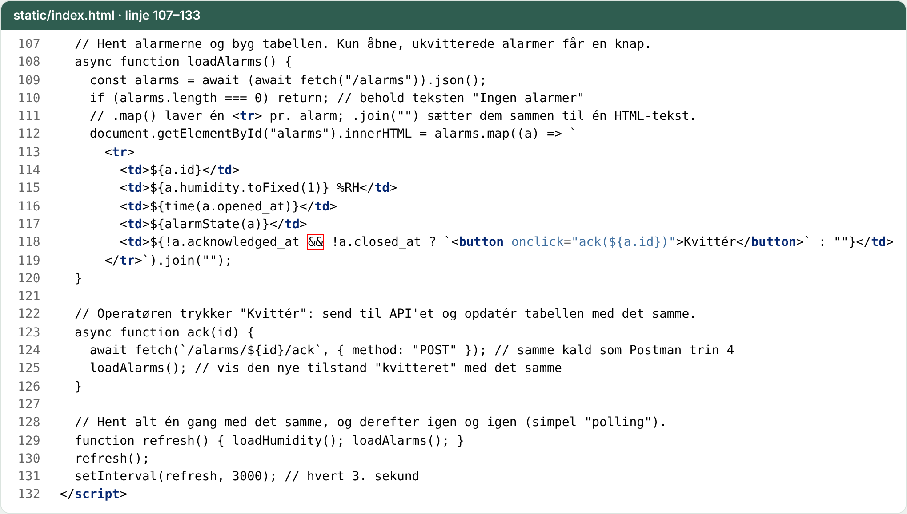

**Hvorfor sådan:**
- Én fil uden framework: det mindste, der viser alarmflowet for operatøren.
- *Polling* med `setInterval(refresh, 3000)`: siden spørger API'et hvert 3. sekund. Simpelt og nok til en MVP.
- Kun åbne, ukvitterede alarmer får en **Kvittér**-knap.
- Lufttryk og rystelser er grå *Fase 2 – mockup*-kort med faste tal og ingen kode bagved. De viser vejen frem uden at bygge den.

## 7. `tests/test_mvp.py`: de 5 tests

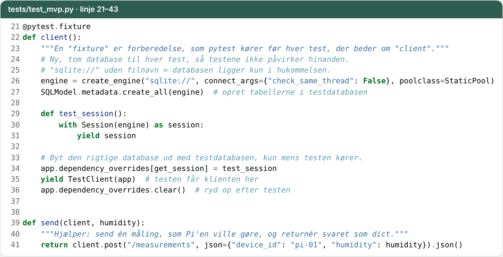

**Hvorfor sådan:** hver test får en ny, tom database i hukommelsen (`sqlite://`). Testene påvirker ikke hinanden og kræver ikke Docker. `dependency_overrides` bytter den rigtige database ud med testdatabasen. Se tabellen *strategi → regel → test* i `KRAV.md`.

**Testene prøver grænserne fra begge sider.** Test 1 tjekker 54,9 (grøn), 55 (gul), 60 (gul) og 60,1 (rød), og at 150 og -5 giver 422 uden at noget gemmes. Test 2 tjekker, at målingen er gemt sammen med alarmen, og at præcis 60 ikke giver alarm. Test 3 tjekker, at "ingen dublet" gælder pr. enhed (en anden Pi får sin egen alarm). Test 4 tjekker, at kvittering ikke lukker alarmen, og at en lukket alarm ikke kan kvitteres. Test 5 tjekker, at præcis 55 ikke lukker alarmen, men at 54,9 gør. Ændrer man en grænse eller et `<` til `<=` i `rules.py`, fejler mindst én test. Prøv det selv: ret `NORMAL_UNDER` til 50 og kør `pytest`.

## 8. Docker: `docker-compose.yml` og `Dockerfile`

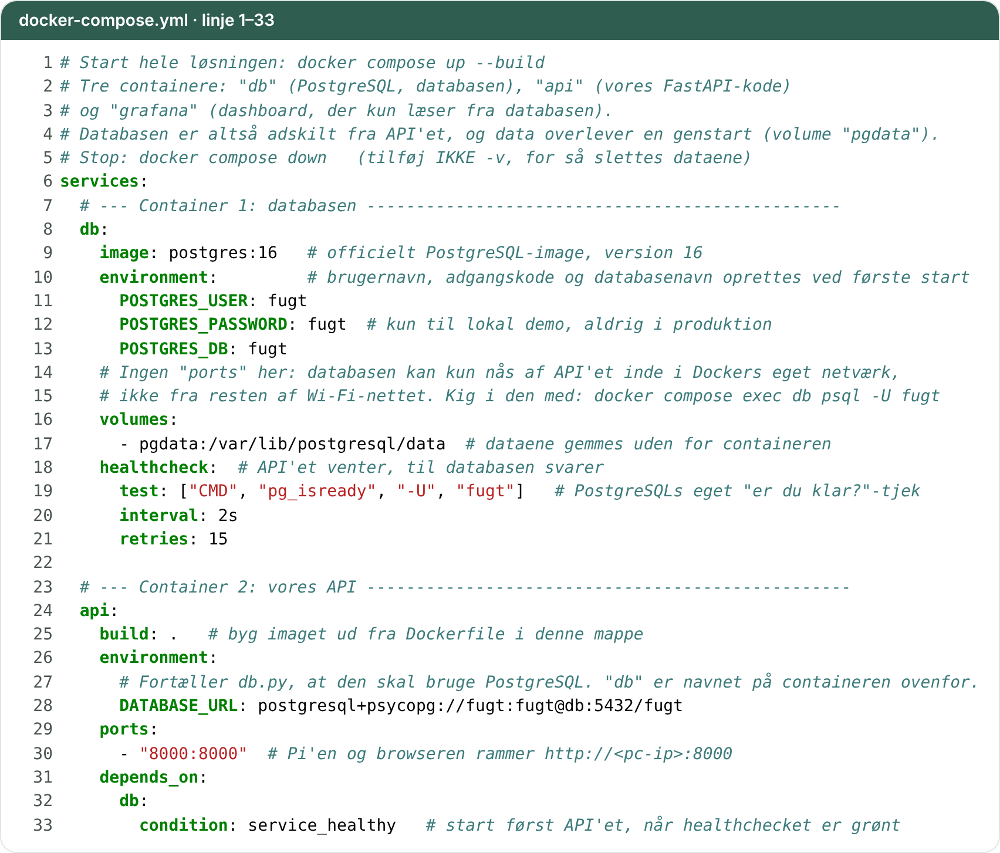

**Hvorfor sådan:**
- Tre containere: `db`, `api` og `grafana`. `db` er opgavens krav om en *separat* database; `grafana` er overvågningen (afsnit 10).
- `volumes: pgdata`: data overlever en genstart.
- `db` har ingen `ports`: databasen kan kun nås af API'et inde i Dockers eget netværk og ikke fra resten af Wi-Fi-nettet. Man kigger i den med `docker compose exec db psql -U fugt`.
- `healthcheck` + `condition: service_healthy`: API'et starter først, når databasen svarer. Ellers ville `create_tables()` fejle ved opstart.

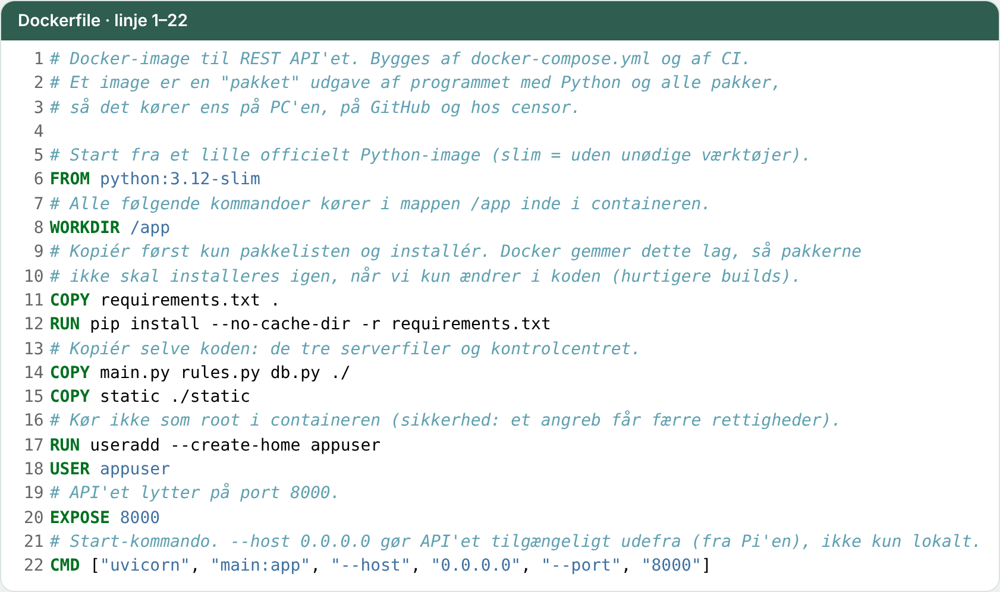

**Hvorfor sådan:**
- `requirements.txt` kopieres før koden, så Docker kan genbruge pakkelaget, når kun koden ændres.
- `USER appuser`: containeren kører ikke som root (sikkerhed).
- `--host 0.0.0.0`: API'et kan nås fra andre maskiner, fx Pi'en, og ikke kun fra PC'en selv.

## 9. CI/CD: `.github/workflows/ci.yml`

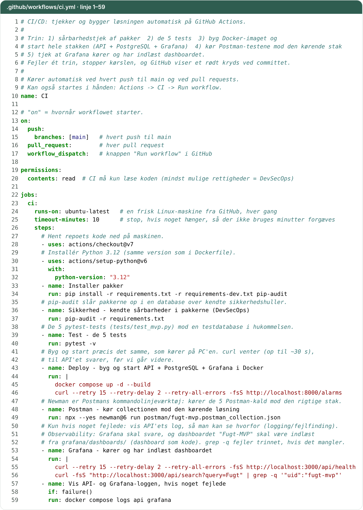

**Hvorfor sådan:** ved hvert push til `main` kører GitHub fire trin. Fejler ét, stopper det hele:

1. **pip-audit**: kendte sikkerhedshuller i pakkerne (DevSecOps).
2. **pytest**: de 5 tests.
3. **Docker**: byg og start præcis den stak, der kører på PC'en (API + PostgreSQL + Grafana).
4. **Newman**: de 5 Postman-kald mod den kørende stak, med rigtig PostgreSQL.
5. **Grafana**: `/api/health` skal svare, og søgningen efter "Fugt" skal finde dashboardet `fugt-mvp`. Så ved vi, at dashboard-filen er gyldig og blev indlæst.

`permissions: contents: read` giver CI mindst mulige rettigheder. Fejler noget, vises API'ets og Grafanas log.

## 10. Grafana: overvågning af driften (`grafana/`)

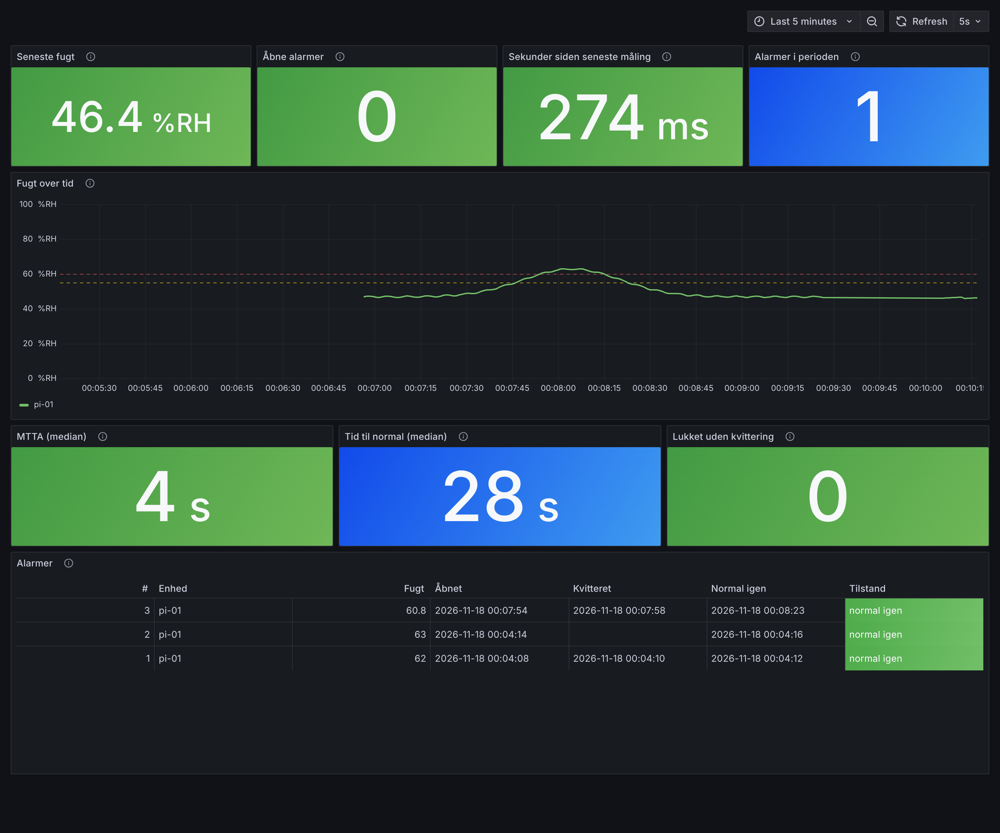

Åbn http://localhost:3000 (ingen login; man kan kun se, ikke ændre). Dashboardet "Fugt-MVP: overvågning" er forsiden.

**Hvordan det virker:** Grafana er en færdig container (`grafana/grafana:11.4.0`). Der er **ingen ny Python-kode**.
Grafana læser selv direkte fra de to tabeller `measurement` og `alarm` med almindelig SQL. Alt er sat op med filer
(*provisioning* = "opsætning som kode"), så dashboardet er det samme hver gang, også i CI:

- `provisioning/datasources/postgres.yml`: hvordan Grafana når databasen (`db:5432`, inde i Dockers netværk).
- `provisioning/dashboards/dashboards.yml`: "læs dashboards fra mappen `/var/lib/grafana/dashboards`".
- `dashboards/fugt-mvp.json`: selve dashboardet. Hvert panel har én SQL-forespørgsel (`rawSql`). Opdaterer hvert 5. sekund.

**De 9 paneler, og hvorfor de er der:**

| Panel | SQL i korte træk | Hvad det svarer på |
|---|---|---|
| Seneste fugt | nyeste `humidity` | Hvordan står det til lige nu? Farve: grøn < 55, gul 55–60, rød > 60 (samme grænser som `rules.py`) |
| Åbne alarmer | `count(*) WHERE closed_at IS NULL` | Er der noget, der skal handles på? |
| Sekunder siden seneste måling | `now() - max(received_at)` | Lever Pi'en? Gul efter 10 s, rød efter 15 s (Pi'en sender hvert 5. s). Fanger en død sensor, som kontrolcentret ikke viser |
| Alarmer i perioden | `count(*)` i den valgte tidsperiode | Hvor ofte sker det? |
| Fugt over tid | `received_at, humidity` pr. enhed | Kurven med stiplede linjer ved 55 og 60 |
| MTTA (median) | median af `acknowledged_at - opened_at` | Mål 6: hvor hurtigt kvitterer medarbejderen? (Mean Time To Acknowledge) |
| Tid til normal (median) | median af `closed_at - opened_at` | Hvor længe varer en alarm? (tæt på MTTR, Mean Time To Resolve) |
| Lukket uden kvittering | lukkede alarmer uden `acknowledged_at` | Alarmer, ingen nåede at se |
| Alarmer (tabel) | de 20 nyeste alarmer + tilstand | Hele forløbet: åbnet → kvitteret → normal igen |

**Hvorfor sådan:**
- **Hvorfor Grafana, når vi har kontrolcentret?** Kontrolcentret er til *medarbejderen*, der skal kvittere for én alarm.
  Grafana er til *driften*: hvordan går det over tid, og hvor hurtigt reagerer vi? Det er forskellen på monitorering og
  observability (Goniwada 2021, kap. 19).
- **Hvorfor læse direkte fra databasen?** Tidsstemplerne `opened_at`, `acknowledged_at` og `closed_at` findes allerede.
  MTTA og tid til normal er bare forskellen mellem dem. Ingen ny kode, ingen ny database.
- **Hvorfor median og ikke gennemsnit?** Én alarm, der blev glemt natten over, ville trække gennemsnittet helt skævt.
- **Sikkerhed:** anonyme brugere er kun `Viewer`, og `editable: false` + `:ro` (read-only) på mapperne betyder, at
  dashboardet ikke kan ændres fra browseren. Kodeordet `fugt` er kun til lokal demo, ligesom i `docker-compose.yml`.
  I produktion skulle Grafana have sin egen databasebruger, der kun må læse.

## 11. Hvad er bevidst IKKE med (bare minimum)

Opgaven kræver ikke disse ting, så de er udeladt og nævnt i rapportens refleksion som vejen frem:
login/API-nøgler, migrationer (Alembic), lufttryk og rystelser som rigtige målinger, mørkt tema, deploy til cloud,
alarmering fra Grafana (fx SMS/mail ved rød), og logs/traces i Grafana (Loki/Tempo).

## Svære spørgsmål til eksamen, og hvad du svarer

Spørgsmålene kommer fra en kritisk gennemgang af opgaven (en "bad cop"-bedømmer).

**"Hvordan har I målt, at alarmen kommer i tide?"**
Alarmen oprettes i samme kald, som målingen modtages i (test 2), så serveren har ingen forsinkelse. Pi'en måler hvert
5. sekund, og kontrolcentret henter nye data hvert 3. sekund. Derfor ser medarbejderen alarmen efter højst ca. 8 sekunder.
Det er regnet ud fra de to intervaller, ikke målt med stopur.

**"Kan en alarm lukke uden at være kvitteret?"**
Ja. Kvittering betyder "jeg har set den", og kun en normal måling lukker alarmen. Falder fugten hurtigt, lukker alarmen
uden kvittering og kan ikke kvitteres bagefter (409). Derfor siger mål 4 i rapporten, at hvert skridt *får et tidspunkt,
når det sker*, og ikke at alle alarmer bliver kvitteret. Hvor hurtigt der kvitteres, er mål 6, som kræver en pilot.

**"Hvad beviser jeres tests om hysteresen?"**
Test 5 sender 62 (alarm), 57 og præcis 55 (alarmen er stadig åben) og til sidst 54,9 (alarmen lukker). Ændrer man 55
til en anden værdi eller `<` til `<=`, fejler testen.

**"I har to core contexts, men én service og én database. Hvor går grænsen?"**
Grænsen går mellem *modtagelsen* af målingen (`MeasurementIn` og tabellen `measurement`, context'en Enhed & Måling) og
*vurderingen* af den (`rules.py` og tabellen `alarm`, context'en Overvågning & Alarm). I MVP'en bor de i samme service,
fordi de er små, og fordi måling og alarm skal gemmes i samme transaktion. Med mange enheder ville modtagelsen blive sin
egen service, som sender målingerne videre som hændelser.

**"Hvorfor hedder feltet `closed_at`, når I siger 'normal igen'?"**
Koden er skrevet på engelsk og rapporten på dansk. Det er samme begreb: `opened_at` = åbnet, `acknowledged_at` =
kvitteret, `closed_at` = normal igen (i kontrolcentret står der "normaliseret"). "Medarbejderen" i rapporten er
"operatøren" i kodekommentarerne.

**"Er det her lagdelt arkitektur?"**
I lille skala: `main.py` er API-laget, `rules.py` er domænelaget og kender hverken database eller HTTP, og `db.py` er
datalaget. Databaseforespørgslen efter en åben alarm står dog i `main.py`. I den store udgave (RaspPI-repoet) ligger
den i et repository-lag. Det har vi fravalgt her for at holde koden på tre filer.

**"Hvad sker der, hvis to røde målinger kommer i samme øjeblik?"**
Så kan der i teorien blive to åbne alarmer, fordi vi har fravalgt låsning (se "Bevidst fravalgt" i `KRAV.md`). Med én
Pi, der sender hvert 5. sekund, sker det ikke. Den store udgave løser det med en rækkelås.
