# Fra sensor til alarm: Fugtovervågning hos IIS {.unnumbered .del}

**Rapportens røde tråd.** Rapporten følger én linje fra forretning til kode: Afsnit 1 begrunder ud fra strategien, hvorfor vi løser netop dette problem, og hvilke målbare mål løsningen skal nå. Afsnit 2 tager skridtet fra Event Storming i delopgave 1 til bounded contexts, et context map og en teknisk arkitektur. Afsnit 3 viser koden, der realiserer de valgte contexts, og afsnit 4 og 5 viser, hvordan den testes og køres automatisk. Afsnit 6 holder resultatet op mod målene. Fagord er forklaret i bilag D.

## 1. Problem og domæne

### 1.1. Strategisk udgangspunkt: fra case til value stream

Intelligent IoT Solutions A/S, som vi kalder IIS, sælger IoT-enheder (Internet of Things: sensorer og maskiner, der sender data over internettet) til energisektoren. IIS har tre strategiske fokusområder, og det første er *værdiskabelse gennem datadrevet drift og service* (Casebeskrivelse, 2026). Det nye forretningsområde *Managed Services*, hvor IIS overvåger kundernes anlæg døgnet rundt fra et kontrolcenter i Aalborg, skal stå for mindst 10 % af omsætningen inden for fem år. I Business Model Canvas-termer (Osterwalder og Pigneur, 2010) er det en ny indtægtsstrøm (et abonnement) til kundesegmentet energiselskaber med egne anlæg. Den leveres gennem kontrolcentret som kanal og bygger på IIS' vigtigste ressourcer: egne enheder, data og kontrolcentret. Tabel 1 viser med et Value Proposition Canvas (Osterwalder et al., 2014), hvad kunden med en Managed Services-aftale har brug for, og hvordan MVP'en svarer på det.

| Kundeprofil (B2B-kunde med Managed Services-aftale) | Værdiforslag: sådan svarer MVP'en |
|---|---|
| **Opgave:** holde anlægget, fx en vindmølle, kørende og producerende | Måler tilstanden løbende og viser den i kontrolcentret |
| **Smerte:** uplanlagte stop, fordi fugt giver rust og kortslutning, som opdages for sent | Alarm ved første kritiske måling, før skaden sker |
| **Smerte:** alarmtræthed, når samme fejl giver mange alarmer | Højst én åben alarm ad gangen og hysterese ved grænsen |
| **Gevinst:** højere oppetid og dokumentation for den | Alle målinger og alarmer gemmes med tidspunkter |

::: {custom-style="Billedtekst"}
(Tabel 1, egen fremstilling (2026): Value Proposition Canvas for Managed Services-kunden, koblet til MVP'en)
:::

**Hvorfor value stream VS7?** En value stream er de trin, en kunde går igennem for at få et resultat. I delopgave 1 valgte vi VS7: *Få anlæg overvåget og vedligeholdt proaktivt*. Valget hviler på en optælling, hvor vi holdt VS7 op mod de seks andre value streams og talte, hvor mange L2- og L3-capabilities (forretningsevner på niveau 2 og 3) fra de otte udvalgte L1-capabilities hver af dem bruger (Delopgave 1, 2026, s. 6). VS7 bruger flest, nemlig 18, foran VS1 (15), VS2 og VS6 (11), VS3 (9), VS4 (7) og VS5 (6). VS7 er altså den value stream, hvor strategien rammer flest vigtige evner på én gang, og den er direkte knyttet til vækstmålet for Managed Services. MVP'en dækker de to trin i VS7, som alt andet afhænger af: *Få anlægget overvåget i realtid* og *Blive varslet om afvigelser i tide*.

**Capabilities går på tværs af value streams.** Tabel 2 viser, at de capabilities, MVP'en bygger, ikke kun bruges i VS7. Measurement Management indgår i fire value streams og Device Management i seks. En fælles tjeneste til målinger og alarmer kan derfor genbruges af andre value streams, fx VS2 og VS3. Det gør evnerne strategisk vigtige flere steder og er et argument for at bygge dem først (Business Architecture Guild, u.å.).

| Capability (L1) | Bruges i | Det bygger MVP'en (L2/L3) |
|---|---|---|
| Measurement Management | VS2, VS3, VS4, VS7 | Measurement Collection, Anomaly Detection, Dashboard Provisioning |
| Device Management | VS1, VS2, VS3, VS5, VS6, VS7 | Device Status Monitoring (farven på Pi'en og seneste måling) |
| Asset Management | VS3, VS4, VS7 | Alert Management (alarm, kvittering, normal igen) |
| Service Management | VS1, VS2, VS6, VS7 | Ikke bygget, næste skridt (servicesag, afsnit 6.3) |

::: {custom-style="Billedtekst"}
(Tabel 2, egen fremstilling (2026) ud fra optællingen i delopgave 1: De fire centrale capabilities og de value streams, de indgår i)
:::

### 1.2. Problemformulering og målbare mål

Opgaven beder os om scenariet *Predictive Maintenance / notifikation* med hændelserne *Sensor Value Received* (en måling er modtaget) og *Anomaly Detected* (en afvigelse er opdaget), et tjek mod en grænse som beslutning og en alarm som handling (Erhvervsakademi København, 2026). Vi har bygget det mindste, der viser hele kæden, lidt ligesom en røgalarm: En Raspberry Pi (en lille computer, herefter Pi'en) med sensorkortet Sense HAT måler luftfugtigheden, serveren opretter en alarm, hvis den er for høj, og en medarbejder kvitterer i et kontrolcenter. Alt gemmes i en database.

Problemstillingen er: *Hvordan kan IIS med en lille webtjeneste gøre målinger fra sensorer til alarmer, som medarbejderne kan handle på i tide, og hvordan kan løsningen bygges, testes og startes automatisk?*

Tabel 3 gør "i tide" og "kan handle på" målbart. Mål 1–5 er eftervist på MVP'en med de tests og kørsler, der står i sidste kolonne. Mål 6–8 er vores forslag til, hvad IIS skal måle i en pilot hos en rigtig kunde.

| Mål | Sådan måles det | Status |
|---|---|---|
| 1. En kritisk måling giver alarm med det samme | Alarmen oprettes i samme kald som målingen. Den ses i kontrolcentret efter højst ca. 8 sek. (måling hvert 5. og opdatering hvert 3. sek.) | Opfyldt: test 2. De 8 sek. følger af de to intervaller |
| 2. Ingen alarmstøj | Ekstra alarmer ved gentagne røde målinger fra samme enhed: 0 | Opfyldt (test 3) |
| 3. Ingen halve data | Måling og alarm gemmes samlet i én transaktion (ét `commit`) | Opfyldt: test 2 og kodeuddrag 4 |
| 4. Ansvar kan ses | Hvert skridt i alarmens liv får sit eget tidspunkt: åbnet, kvitteret og normal igen | Opfyldt (test 4 og 5) |
| 5. Hurtig og sikker levering | Automatisk kontrol pr. ændring: under 2 min. | Opfyldt: 50 sek. (kørsel 12) |
| 6. Kort reaktionstid | Median fra alarm til kvittering (`opened_at` → `acknowledged_at`): under 15 min. | Pilot |
| 7. Færre uplanlagte stop | Stop pga. fugt over 12 måneder mod året før: 30 % færre | Pilot |
| 8. Vækst i Managed Services | Mindst 10 % af omsætningen inden for fem år (Casebeskrivelse, 2026) | Strategisk mål |

::: {custom-style="Billedtekst"}
(Tabel 3, egen fremstilling (2026): Målbare mål for løsningen. Grænserne i mål 6 og 7 er vores foreslåede mål)
:::

### 1.3. Afgrænsning

Kun luftfugtighed bliver målt rigtigt. Lufttryk og rystelser vises som grå kort med teksten *Fase 2 – mockup*, så man kan se, hvordan løsningen kan vokse. Grænserne er valgt til demonstration og ikke til en bestemt maskine. Løsningen opdager afvigelser, når de sker, men forudsiger ikke fejl. Vi byggede først en langt større udgave, men skar den ned, så hver linje kode kan forklares og føres tilbage til opgavens krav (se afsnit 6.3).

## 2. Domæne og løsningsdesign

### 2.1. Fra Event Storming til bounded contexts

I delopgave 1 brugte vi Event Storming, en workshopmetode hvor alle hændelser i en proces sættes op på en tidslinje (Brandolini, 2013). Den gav fire procesfaser: Device, Håndtering, Service case og Execution (Delopgave 1, 2026). En fase siger dog kun, *hvornår* noget sker, ikke *hvem* der ejer reglerne. Næste skridt er derfor at afgrænse bounded contexts: områder med eget ansvar og eget sprog (Evans, 2003). Vi har grupperet hændelserne efter, hvem der bestemmer over dem, og hvilke ord de bruger. Figur 1 viser øverst Event Storming i forenklet form med en farveforklaring og nederst de fire contexts, vi kom frem til.

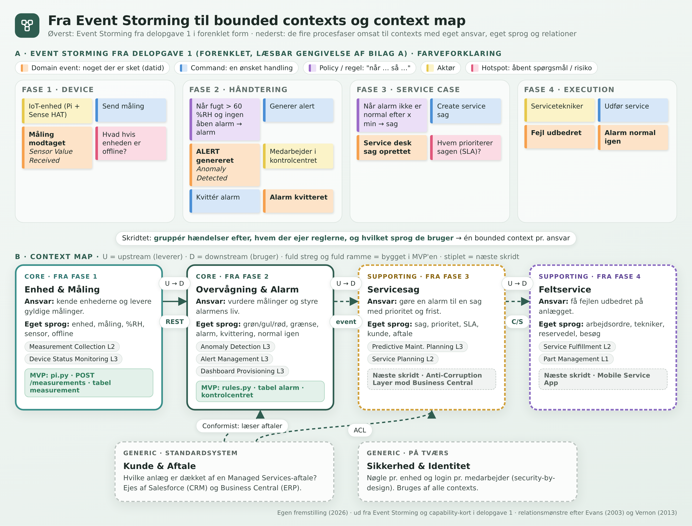{width=100%}

::: {custom-style="Billedtekst"}
(Figur 1, egen fremstilling (2026): Fra procesfaser til bounded contexts og context map. Farverne øverst følger Brandolinis standard: orange = domain event, blå = command, lilla = policy, gul = aktør, rød = hotspot)
:::

Sproget er det, der skiller dem ad. I *Overvågning & Alarm* er en alarm en tilstand med tre tidspunkter: åbnet, kvitteret og normal igen. I koden hedder de `opened_at`, `acknowledged_at` og `closed_at`, og medarbejderen i kontrolcentret kaldes operatøren. I *Servicesag* er samme alarm kun anledningen til en sag med prioritet og frist (SLA, Service Level Agreement). Derfor hører de til hver sin context. *Enhed & Måling* og *Overvågning & Alarm* er core, fordi det er her, IIS skiller sig ud. *Servicesag* og *Feltservice* er supporting, og *Kunde & Aftale* er generic, fordi standardsystemerne Salesforce og Business Central allerede dækker den. Det samme gælder *Sikkerhed & Identitet*, som alle contexts bruger.

### 2.2. Context map: sådan hænger de sammen

Context mappet (figur 1, nederst) viser relationerne efter Vernon (2013). *Enhed & Måling* er upstream for *Overvågning & Alarm* i en kunde-leverandør-relation, hvor målingen sendes i et fast, offentligt format (Published Language): JSON med enhed og fugt over REST. *Overvågning & Alarm* bliver upstream for *Servicesag* ved at offentliggøre hændelsen "alarm oprettet" (`AlarmCreated`) på en event-bus, så servicesystemet ikke behøver at kende vores kode. *Servicesag* afgør med sin egen regel, hvornår en alarm bliver til en sag, fx når den ikke er normal igen efter et antal minutter, og er selv leverandør til *Feltservice* (C/S i figuren). *Servicesag* beskytter sig mod Business Centrals datamodel med et Anti-Corruption Layer, et oversætterlag. Over for *Kunde & Aftale* er vi conformist: vi bruger CRM-systemets model, som den er. MVP'en realiserer bevidst de to core contexts, fordi det er dem, de to første VS7-trin kræver. De er så små, at de deler én service og én database. Grænsen går mellem modtagelsen af målingen (`MeasurementIn` og tabellen `measurement`) og vurderingen af den (`rules.py` og tabellen `alarm`), så de kan skilles ad, når der kommer mange enheder.

### 2.3. Arkitekturmønstre og teknisk arkitektur

Delopgave 1 pegede på en event-drevet, modulær og API-first arkitektur i en cloud-first strategi. Figur 2 viser, hvilke komponenter der realiserer de fire contexts, og hvilke mønstre vi har valgt. Fuld ramme er bygget, og stiplet er målbilledet.

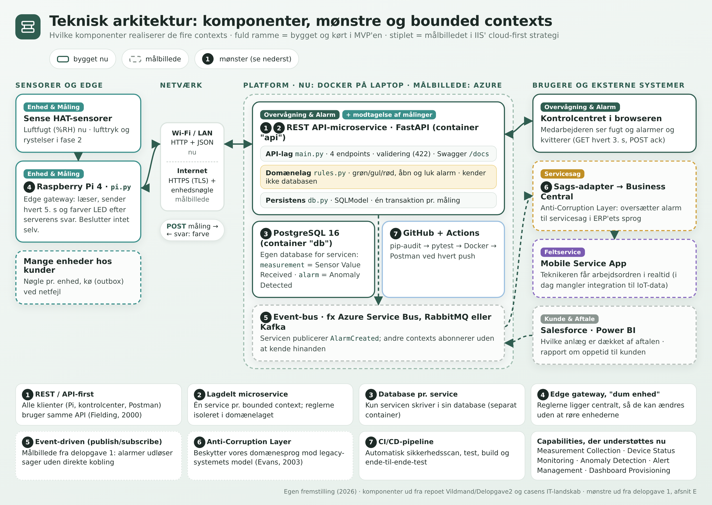{width=100%}

::: {custom-style="Billedtekst"}
(Figur 2, egen fremstilling (2026): Teknisk arkitektur med sensorer, netværk, REST API, database, CI/CD, event-bus og eksterne systemer. Farven på hver komponent viser dens bounded context, og numrene er arkitekturmønstrene)
:::

De vigtigste mønstre er: **(1) REST og API-first**, så Pi'en, kontrolcentret og Postman bruger samme indgang (Fielding, 2000). **(2) En lagdelt microservice** for context'en *Overvågning & Alarm* med reglerne isoleret i et domænelag (Richards og Ford, 2020). I MVP'en er lagene tre filer: `main.py` (API), `rules.py` (domæne) og `db.py` (data). **(3) Database pr. service**, så kun servicen skriver i sin egen PostgreSQL, som ikke kan nås fra netværket (Newman, 2021). **(4) Edge gateway**: Pi'en måler og viser, men beslutter intet, så reglerne kan ændres uden at røre enhederne. I målbilledet kommer **(5) event-drevet publish/subscribe** via en event-bus, så en alarm kan blive til en servicesag og en arbejdsordre i Mobile Service App uden direkte kobling, og **(6) et Anti-Corruption Layer** mod Business Central. Netværket er i dag Wi-Fi med HTTP. I målbilledet bliver det HTTPS med en nøgle pr. enhed, og den samme container flyttes til Azure. **(7) CI/CD-pipelinen** sikrer, at hver ændring testes, før den tages i brug.

### 2.4. Event-flowet: hændelse, beslutning og handling

1. **Hændelse:** Pi'en sender en måling, fx 62,0 %RH, til `/measurements` (*Sensor Value Received*). Målingen bliver gemt.
2. **Beslutning:** Reglen siger grøn under 55 %RH, gul fra 55 til 60 og rød over 60.
3. **Handling:** Er målingen rød, og er der ikke allerede en alarm, oprettes en alarm (*Anomaly Detected*). Svaret fortæller Pi'en, at lysdisplayet skal lyse rødt.
4. **Afslutning:** En medarbejder kvitterer ("jeg har set den"). Alarmen lukker af sig selv, når fugten er under 55 %RH igen. At den først lukker under 55, kaldes hysterese, og det forhindrer, at alarmen blinker ved grænsen.

Diagram 6 i bilag B viser reglerne og en alarms liv i fuld størrelse. Event Storming-kæden "Fejl rapporteret" → "Generer alert" → "ALERT genereret" fra delopgave 1 er netop det, løsningen udfører. "ALERT genereret" er det samme som opgavens *Anomaly Detected*: en ny række i tabellen `alarm` og i målbilledet beskeden `AlarmCreated` på event-bussen. Tabel 4 samler den røde tråd i én tabel: fra strategi over capability og context til regel og test. Hver regel har præcis én test, som også prøver værdien lige ved siden af grænsen, fx 54,9 og 55.

| Fra delopgave 1 (strategi) | Capability → context | Regel i koden | Test |
|------|-----|------|---|
| Evnen til at følge hver enheds tilstand | Device Status Monitoring → Enhed & Måling | `status()`: grøn under 55, gul 55–60, rød over 60 | 1. farverne |
| Event Storming: "Fejl rapporteret" → "Generer alert" | Anomaly Detection → Overvågning & Alarm | `should_open_alarm()`: en rød måling opretter en alarm | 2. alarm over 60 |
| Medarbejderne må ikke drukne i alarmer | Alert Management → Overvågning & Alarm | Ingen ny alarm, mens enheden allerede har en | 3. ingen dobbelte alarmer |
| Medarbejderen tager ansvar for alarmen | Alert Management → Overvågning & Alarm | Kvittering: `POST /alarms/{id}/ack` | 4. kvittering |
| Alarmen må ikke blinke ved grænsen | Alert Management → Overvågning & Alarm | `should_close_alarm()`: lukker først under 55 (hysterese) | 5. normalisering |

::: {custom-style="Billedtekst"}
(Tabel 4, egen fremstilling (2026): Den røde tråd fra strategi over capability og context til regel og test)
:::

## 3. Implementering

### 3.1. Sådan er løsningen bygget op

Løsningen er skrevet i Python med FastAPI, et værktøj til hurtigt at bygge et API, som også automatisk laver en vejledning til API'et, der hedder Swagger. Data gemmes i PostgreSQL, en gratis og udbredt database. Vi bruger Python både på Pi'en og på serveren, fordi det gør koden lettere at forklare. Selve serveren er kun tre filer: `main.py` med API'et, `rules.py` med reglerne og `db.py` med databasen. Dertil kommer kontrolcentret (`static/index.html`) og programmet på Pi'en (`pi/pi.py`), i alt ca. 250 kodelinjer plus danske kommentarer til næsten hver linje (bilag C).

**Reglerne** er hjertet i løsningen (bilag A, kodeuddrag 1). De ligger i deres egen fil og kender hverken databasen, netværket eller Pi'en. **Hvorfor:** Så kan de testes på en brøkdel af et sekund, og hvis IIS vil ændre grænserne, skal det kun ske ét sted. Betingelsen `and not alarm_already_open` sørger for, at ti røde målinger i træk kun giver én alarm.

**API'et** har fire endpoints (tabel 5). Programmer bruger dem ved at sende forespørgsler over HTTP (Hypertext Transfer Protocol, det samme "sprog", en browser bruger). Endpointet, der modtager målinger, har de tre trin hændelse, beslutning og handling som tre kommentarer i koden (bilag A, kodeuddrag 4). **Hvorfor:** Det spørger reglerne i stedet for selv at sammenligne tal, så forretningsreglerne kun ligger ét sted. API'et er dokumenteret i Swagger på adressen `/docs`, hvor man også kan prøve det af, og i projektets README-fil på GitHub (projektets "læs mig først"-side).

| Hvad man gør | Adresse | Hvem bruger det |
|-------|-----|-----|
| Sende en ny måling, som serveren vurderer med det samme | POST `/measurements` | Pi'en og Postman |
| Se de seneste målinger | GET `/measurements` | Kontrolcentret |
| Se de seneste alarmer | GET `/alarms` | Kontrolcentret og Postman |
| Kvittere for en alarm | POST `/alarms/{id}/ack` | Kontrolcentret og Postman |

::: {custom-style="Billedtekst"}
(Tabel 5, egen fremstilling (2026): API'ets fire endpoints)
:::

### 3.2. Data, Pi'en og kontrolcentret

Databasen har to tabeller, som gemmer begge hændelser fra opgaven (bilag A, kodeuddrag 5). Hver række i `measurement` er en *Sensor Value Received* med enhed, fugt, farve og tidspunkt. Hver række i `alarm` er en *Anomaly Detected* med tre tidspunkter: oprettet, kvitteret og normal igen. Målingen og en eventuel alarm bliver gemt i én samlet arbejdspakke, en transaktion, så der aldrig kun bliver gemt halvdelen. Data bliver tjekket først: fugten skal ligge mellem 0 og 100 %RH, ellers svarer API'et med fejlkode 422 ("forkerte data") og gemmer intet.

Programmet på Pi'en tager udgangspunkt i undervisningens eksempel (Eftekhari, 2026). Pi'en måler hvert 5. sekund og sender til den bærbare computers adresse på netværket (`http://192.168.0.103:8000`). Det viser, at API'et kan nås fra en anden computer, som opgaven kræver. Pi'ens LED-display (Light Emitting Diode, lysdiode) lyser grønt, gult eller rødt efter serverens svar og blåt, hvis serveren ikke kan nås (kodeuddrag 6). Kontrolcentret er en hjemmeside, som serveren selv leverer. Den henter nye data hvert 3. sekund og viser fugten, alarmerne og en Kvittér-knap (bilag B, skærmbillede 1).

## 4. DevSecOps og deployment

Deployment betyder at få løsningen i gang på den computer, hvor den skal køre. Vores løsning kører lokalt i Docker og startes med én kommando: `docker compose up --build`. Den bygger koden og starter to containere: `db` med PostgreSQL og `api` med serveren, som venter, til databasen er klar. Data ligger i et Docker-volume (et lager uden for containeren), så de overlever en genstart (kodeuddrag 9 og 10).

Koden ligger på GitHub. Hver gang vi sender ny kode til hovedgrenen (main), kører GitHub Actions, GitHubs tjeneste til automatiske kørsler, fire trin af sig selv: 1) pakkerne tjekkes for kendte sikkerhedshuller (pip-audit), 2) de 5 automatiske tests køres (pytest), 3) containeren bygges, og server og PostgreSQL startes på GitHubs computer, og 4) Postman-testene køres mod den kørende løsning (Newman). Fejler ét trin, stopper kørslen, og fejlen kan ses på GitHub (kodeuddrag 11 og bilag B, diagram 5).

Kørslerne har været grønne siden den første automatiske kørsel den 6. november 2026 (bilag B, skærmbillede 2). Kørsel 12 på den endelige kode var grøn i alle trin og tog 50 sekunder (https://github.com/Vildmand/Delopgave2/actions/runs/43131875396). CI-delen er fuldt automatisk. CD-delen er continuous delivery i lille skala: på GitHubs computer bygges containeren, og hele løsningen startes og testes, så den er klar til brug. Selve udrulningen på den bærbare computer, som Pi'en sender til, sker med kommandoen ovenfor.

Sikkerheden er enkel, men med fra starten, som vi anbefalede i delopgave 1. Containeren kører ikke som administrator (root), databasen kan kun nås af serveren inde i Dockers eget netværk, den automatiske kontrol må kun læse koden, og pakkerne scannes ved hver ændring.

## 5. Kvalitet og drift

**Test.** De 5 automatiske tests svarer til de 5 regler i tabel 4 og kører på under et sekund med en tom database i hukommelsen. De prøver begge sider af hver grænse, så en forkert ændring af en regel får en test til at fejle. Postman-samlingen gennemspiller hele alarmforløbet i 5 trin. Alle bestod både lokalt og på GitHub, og vi så rækkerne i PostgreSQL med psql (databasens eget spørgeprogram). Programmet er også afprøvet på den rigtige Pi over Wi-Fi: i et tørt lokale på cirka 28 %RH lyste displayet grønt, og når man puster på sensoren, bliver det rødt, og alarmen dukker op i kontrolcentret.

**Overvågning, fejlhåndtering og logning.** Kontrolcentret viser tidspunktet for den seneste måling, så man kan se, hvis Pi'en er holdt op med at sende, og Pi'en lyser blåt uden forbindelse. Fejler netværket, prøver Pi'en igen 5 sekunder senere. Serveren skriver hver forespørgsel med adresse og svarkode i Docker-loggen (en slags dagbog), som man ser med `docker compose logs api`, og fejler den automatiske kontrol, viser den selv loggen.

## 6. Refleksion

### 6.1. Hvad fungerede godt

Det fungerede bedst at lade delopgave 1 styre koden. Hver regel kan føres tilbage til strategien og har én test (tabel 4), og mål 1–5 i tabel 3 er opfyldt. Da "Generer alert" fra Event Storming blev til "alarm oprettet" i koden, databasen og testene, blev løsningen let at forklare. Det fungerede også godt at skære ned. Vi byggede først en stor udgave med tre måletyper, en logbog over hændelser og 153 tests. Med fem filer kan man følge hele kæden, og alle opgavens krav er stadig opfyldt. Feedbacken på delopgave 1 fik os også til at tage skridtet fra procesfaser til bounded contexts (afsnit 2.1). Det gjorde det lettere at begrunde, hvad MVP'en *ikke* skal indeholde: servicesager og feltservice hører til andre contexts.

### 6.2. Hvad kunne forbedres

Vi burde have startet småt og bygget ud i stedet for omvendt. Én høj måling giver straks en alarm, så et kort pust kan give en falsk alarm. Der er intet login, så alle på netværket kan sende målinger og kvittere, og forbindelsen er ikke krypteret. Kontrolcentret skelner ikke mellem flere enheder, selvom API'et gør, og uden låsning kan to samtidige målinger i teorien give to alarmer. Og løsningen er ikke rigtig forudsigende vedligeholdelse: en fast grænse opdager et problem nu, men forudsiger ikke et senere. Det er mere præcist at kalde den afvigelsesdetektion, som gør vedligeholdelsen proaktiv. Mål 6–8 i tabel 3 kræver en pilot hos en kunde.

### 6.3. Hvordan løsningen kan videreudvikles

Den store udgave ligger urørt i vores første repository (https://github.com/miemosberg2201/RaspPI), så hvert næste skridt er allerede bygget og testet én gang (bilag B, diagram 4). Trinene følger context mappet i figur 1 og tages ét ad gangen, når forretningen har brug for dem, for teknologi skal vælges, fordi den løser et behov (Delopgave 1, 2026):

1. **En mere robust regel:** alarm først efter tre høje målinger i træk, så et kort pust ikke giver alarm.
2. **En logbog over hændelser og en event-bus:** så context'en *Servicesag* kan abonnere på alarmer og oprette sager i Business Central gennem et Anti-Corruption Layer (figur 2).
3. **Flere måletyper, kode i lag og en kø på Pi'en**, så mockup-kortene bliver rigtige, og intet tabes.
4. **Sikkerhed og cloud:** nøgle pr. enhed, login, HTTPS og Azure, så mål 6 og 7 kan måles i en pilot.


## Litteraturliste {.unnumbered}

Brandolini, A. (2013). *Introducing EventStorming*. Leanpub.

Business Architecture Guild (u.å.). *A Guide to the Business Architecture Body of Knowledge (BIZBOK Guide)*. Business Architecture Guild.

Casebeskrivelse (2026). *Intelligent IoT Solutions A/S – en fælles case for 6. semester*. Erhvervsakademi København.

Delopgave 1 (2026). *Strategisk rapport af Intelligent IoT Solutions A/S* med Bilag A (Event Storming). Gruppe 9: Brian Jegindø, Mie Mosberg, Tobias Stryhn, Nicklas Vilmann og Rene Dalby. Erhvervsakademi København.

Evans, E. (2003). *Domain-Driven Design: Tackling Complexity in the Heart of Software*. Boston: Addison-Wesley.

Eftekhari, J. (2026). *IOT_DEMO* [samling af eksempelkode fra undervisningen; IOT står for Internet of Things]. Tilgængelig på: https://github.com/jamshideftekhari/IOT_DEMO.

Erhvervsakademi København (2026). *Afleveringsopgave #2 – Teknisk MVP – REST API Microservice løsning*. Faget 6.2 Design og implementering af digitale løsninger.

Fielding, R.T. (2000). *Architectural Styles and the Design of Network-based Software Architectures*. Doktorafhandling. University of California, Irvine.

Newman, S. (2021). *Building Microservices*. 2. udg. Sebastopol: O'Reilly.

Osterwalder, A. og Pigneur, Y. (2010). *Business Model Generation*. Hoboken: Wiley.

Osterwalder, A., Pigneur, Y., Bernarda, G. og Smith, A. (2014). *Value Proposition Design*. Hoboken: Wiley.

Richards, M. og Ford, N. (2020). *Fundamentals of Software Architecture*. Sebastopol: O'Reilly.

Ries, E. (2011). *The Lean Startup*. New York: Crown Business.

Vernon, V. (2013). *Implementing Domain-Driven Design*. Upper Saddle River: Addison-Wesley.

## Bilag A. Udvalgte kodeuddrag {.unnumbered .bilag}

Billederne er taget af den rigtige kode med de rigtige linjenumre. Koden er skrevet på engelsk, men alle kommentarer i koden er på dansk. Under hvert billede står der kort, **hvorfor** koden er skrevet sådan.

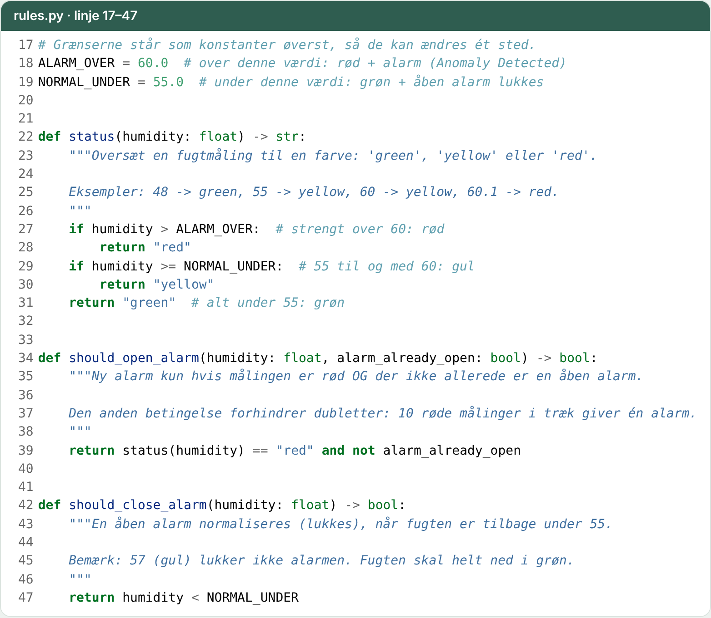{width=80%}

::: {custom-style="Billedtekst"}
(Kodeuddrag 1: Reglerne i rules.py)
:::

**Hvorfor:** Reglerne er rene funktioner uden database og netværk, så de kan testes hurtigt og ændres ét sted. Grænserne 55 og 60 står øverst, så man ikke skal lede efter dem. `and not alarm_already_open` forhindrer dobbelte alarmer, og at alarmen først lukker under 55, er hysteresen.

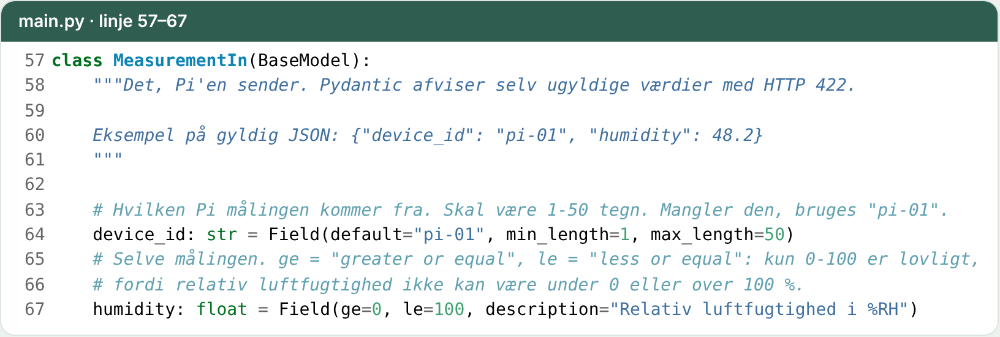{width=92%}

::: {custom-style="Billedtekst"}
(Kodeuddrag 2: Validering af målingen i main.py)
:::

**Hvorfor:** Pydantic tjekker data, før vores egen kode kører. En fugt på 150 eller -5 bliver afvist med fejlkode 422. Så kan reglerne stole på, at tallet er gyldigt. Det er opgavens krav om validering.

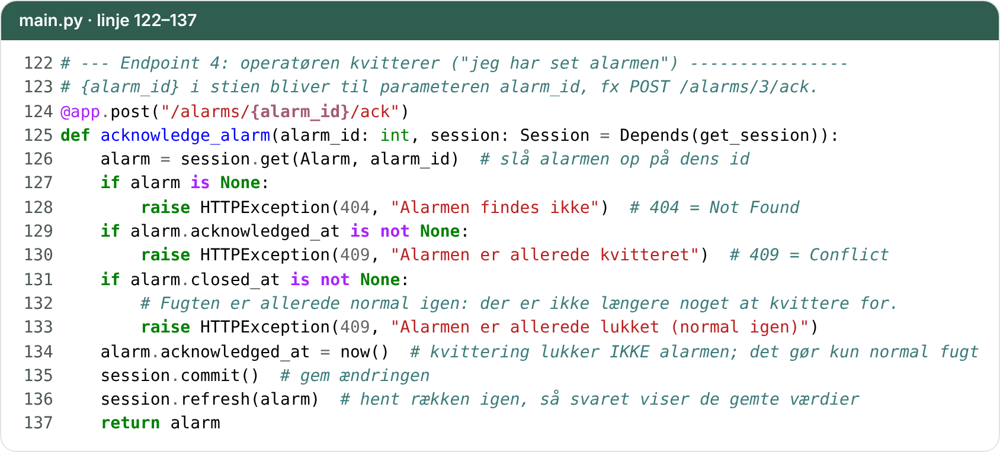{width=92%}

::: {custom-style="Billedtekst"}
(Kodeuddrag 3: Kvittering for en alarm i main.py)
:::

**Hvorfor:** Medarbejderen skal kunne sige "jeg har set den". Kvitteringen lukker ikke alarmen. Det gør kun normal fugt. Så kan man se forskel på "nogen har set problemet" og "problemet er væk". Fejlkode 404 betyder, at alarmen ikke findes, og 409, at den allerede er kvitteret eller lukket.

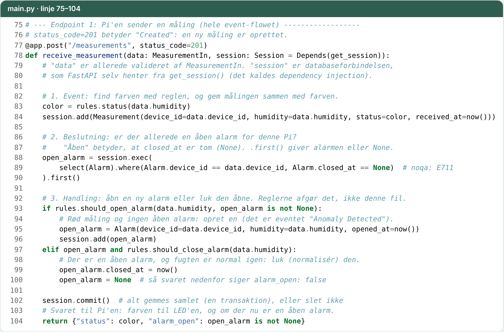{width=92%}

::: {custom-style="Billedtekst"}
(Kodeuddrag 4: Endpointet POST /measurements i main.py, hvor en måling bliver til en farve og måske en alarm)
:::

**Hvorfor:** De tre trin hændelse, beslutning og handling står som tre kommentarer. Endpointet spørger reglerne i stedet for selv at sammenligne tal. `session.commit()` til sidst gemmer måling og alarm i én transaktion, så der aldrig opstår en alarm uden den måling, der udløste den. Svaret er det, Pi'en bruger til at farve lysdisplayet.

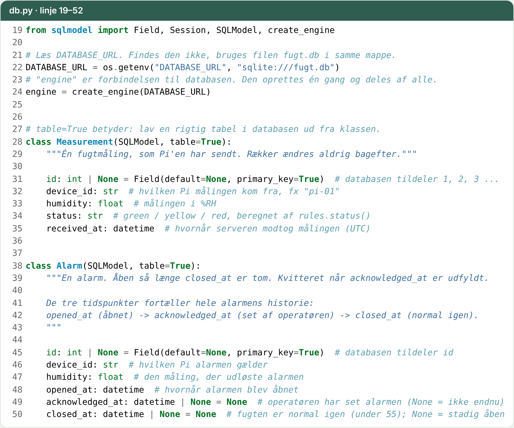{width=92%}

::: {custom-style="Billedtekst"}
(Kodeuddrag 5: Databasens to tabeller i db.py)
:::

**Hvorfor:** Værktøjet SQLModel gør én Python-klasse til både tabellen i databasen og objektet i koden, så vi ikke skriver databasekode i hånden. Alarmens tilstand kan læses ud fra, hvilke af de tre tidspunkter der er udfyldt, så der ikke er et ekstra statusfelt, der kan komme ud af trit. Adressen på databasen kommer udefra (DATABASE_URL), så den samme kode bruger PostgreSQL i Docker og en lille testdatabase i testene.

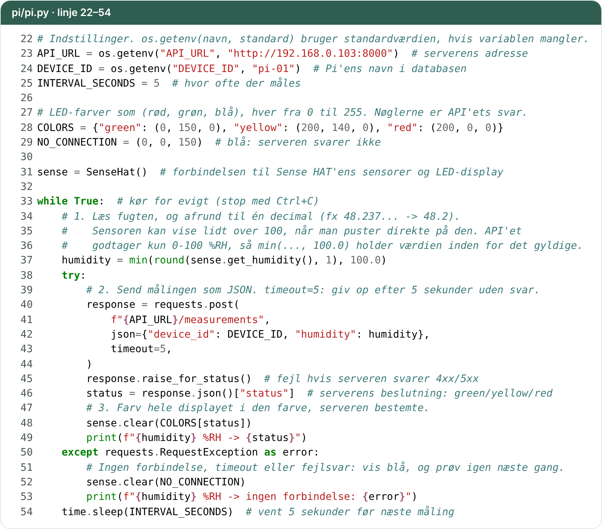{width=92%}

::: {custom-style="Billedtekst"}
(Kodeuddrag 6: Programmet på Pi'en (pi/pi.py))
:::

**Hvorfor:** Pi'en måler, sender og viser svaret, men beslutter intet selv. Så kan reglerne ændres uden at røre Pi'en. Hvis serveren ikke svarer inden for 5 sekunder, hænger Pi'en ikke fast. Den lyser blåt og prøver igen. Målingen holdes på højst 100 %RH, fordi sensoren kan vise lidt over, når man puster på den. Serverens adresse sættes udefra (API_URL), så programmet virker, selvom computerens adresse skifter.

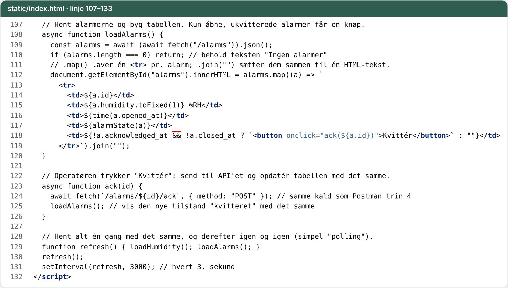{width=92%}

::: {custom-style="Billedtekst"}
(Kodeuddrag 7: Kontrolcentrets JavaScript i static/index.html)
:::

**Hvorfor:** Én fil uden ekstra værktøjer er det mindste, der viser alarmen for medarbejderen. Siden spørger API'et hvert 3. sekund (på engelsk polling). Kun alarmer, der ikke er kvitteret, får en Kvittér-knap.

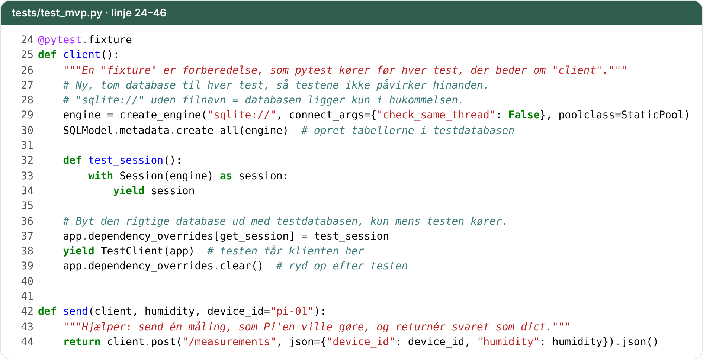{width=92%}

::: {custom-style="Billedtekst"}
(Kodeuddrag 8: Opsætningen af testene i tests/test_mvp.py)
:::

**Hvorfor:** Hver test får sin egen tomme database i computerens hukommelse. Testene påvirker derfor ikke hinanden og kræver ikke Docker. Den rigtige database bliver byttet ud med testdatabasen, uden at koden i main.py skal ændres.

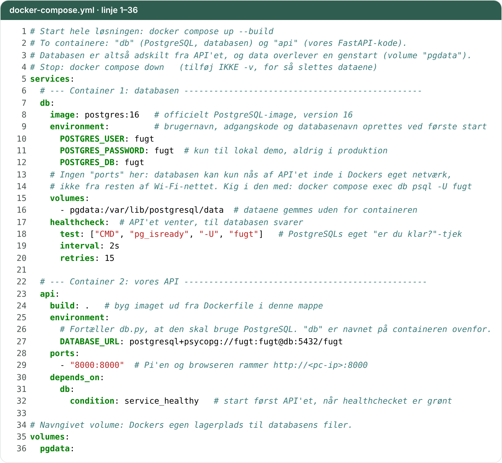{width=92%}

::: {custom-style="Billedtekst"}
(Kodeuddrag 9: De to containere i docker-compose.yml)
:::

**Hvorfor:** Databasen kører i sin egen container, som opgaven kræver. Serveren starter først, når databasen svarer (healthcheck), ellers ville den fejle ved opstart. Data ligger i et volume, så de overlever en genstart. Databasen har ingen åben port mod netværket.

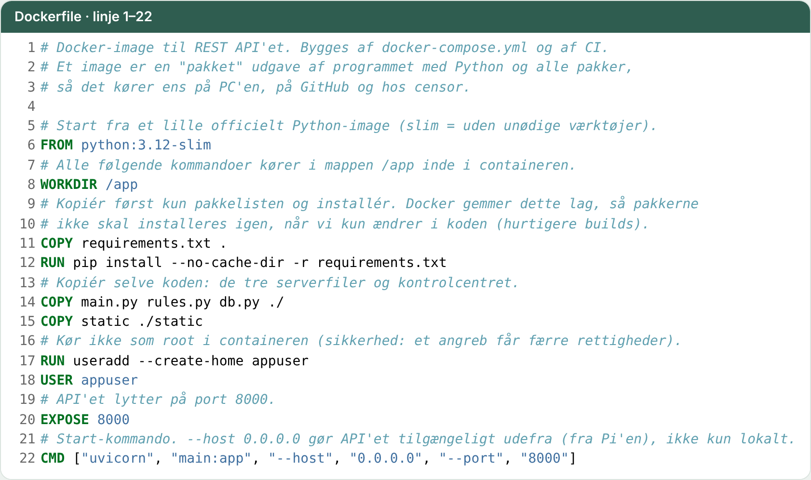{width=92%}

::: {custom-style="Billedtekst"}
(Kodeuddrag 10: Opskriften på serverens container (Dockerfile))
:::

**Hvorfor:** Pakkelisten kopieres før koden, så Docker kan genbruge de installerede pakker, når kun koden ændres. Containeren kører som en almindelig bruger og ikke som administrator (sikkerhed). Adressen 0.0.0.0 betyder, at serveren kan nås fra andre computere, for eksempel Pi'en.

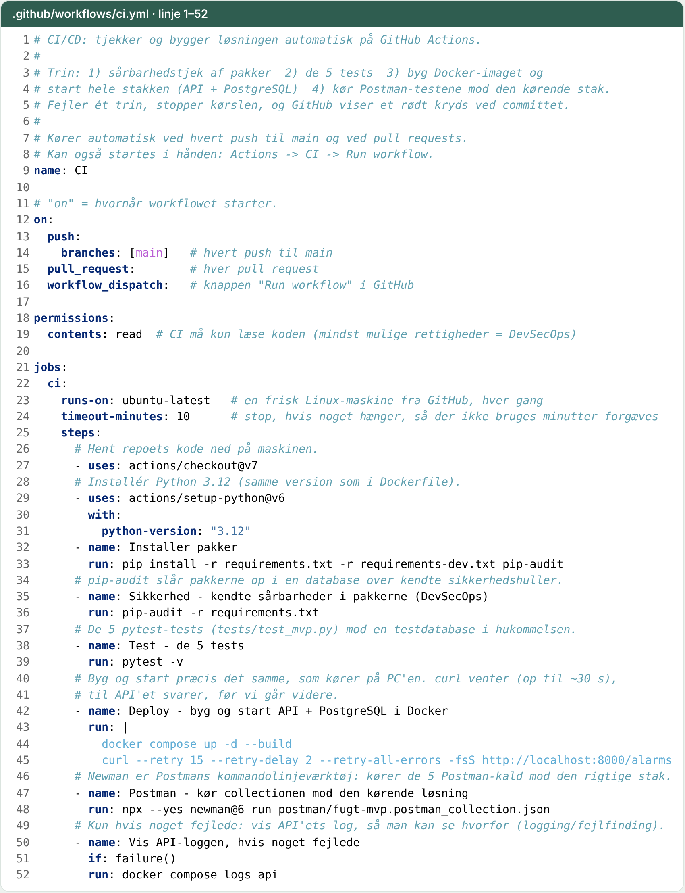{width=92%}

::: {custom-style="Billedtekst"}
(Kodeuddrag 11: Opskriften på den automatiske kontrol (.github/workflows/ci.yml))
:::

**Hvorfor:** Kørslen starter ved hver ændring på main. Den har kun lov til at læse koden (mindst mulige rettigheder). De fire trin kører i rækkefølge, og fejler ét, stopper det hele og viser serverens log.

## Bilag B. Skærmbilleder og flere diagrammer {.unnumbered .bilag}

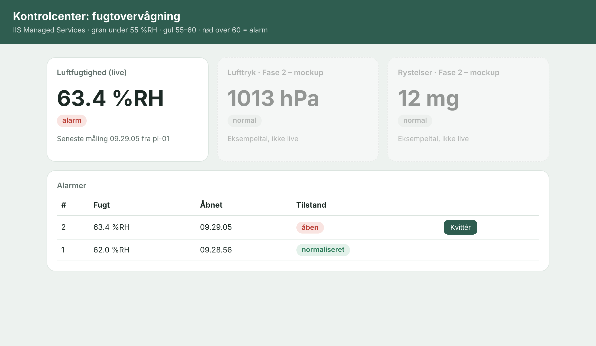{width=75%}

::: {custom-style="Billedtekst"}
(Skærmbillede 1: Kontrolcentret med en aktiv alarm, en alarm der er normal igen, og de grå mockup-kort til fase 2)
:::

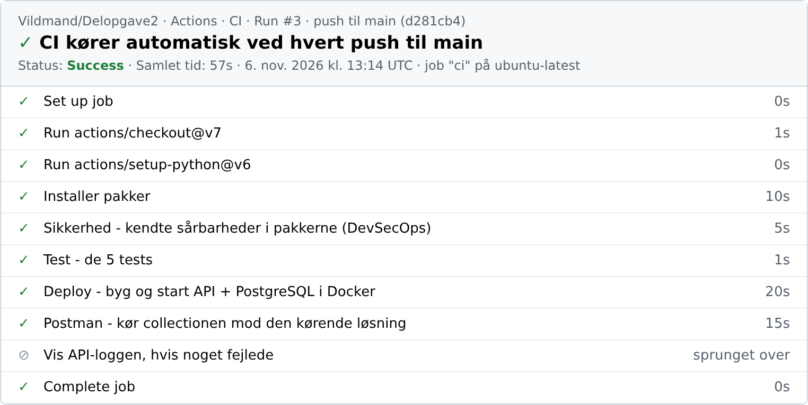{width=70%}

::: {custom-style="Billedtekst"}
(Skærmbillede 2: Den grønne kørsel nummer 3 på GitHub Actions. Trinene og tiderne er gengivet fra kørslens egne data på GitHub. Kørsel 12 på den endelige kode: https://github.com/Vildmand/Delopgave2/actions/runs/43131875396)
:::

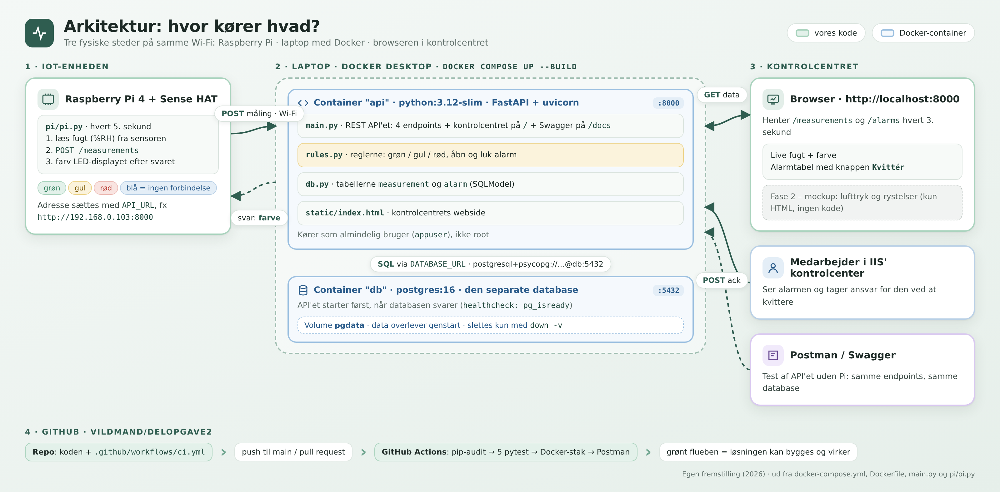{width=100%}

::: {custom-style="Billedtekst"}
(Diagram 1, egen fremstilling (2026): Hvor kører hvad i MVP'en. Pi'en sender målinger over Wi-Fi til serveren og databasen i hver sin Docker-container på den bærbare computer. Kontrolcentret i browseren henter data og kvitterer. Nederst den automatiske kontrol på GitHub)
:::

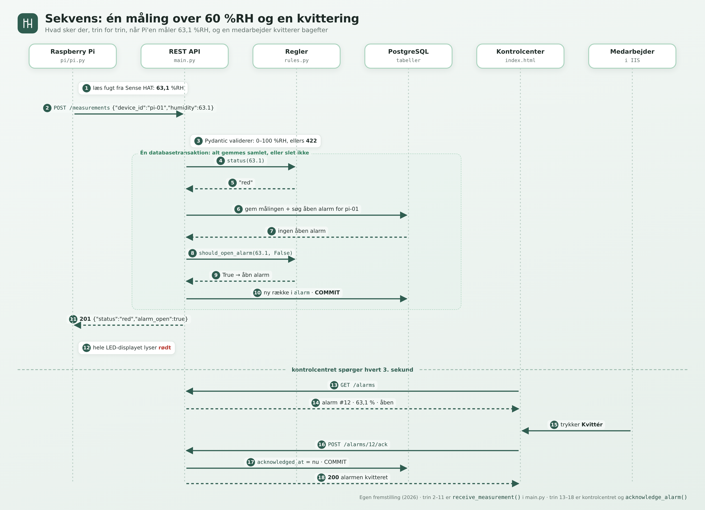{width=100%}

::: {custom-style="Billedtekst"}
(Diagram 2, egen fremstilling (2026): Trin for trin, hvad der sker, når Pi'en måler 63,1 %RH, og når en medarbejder kvitterer)
:::

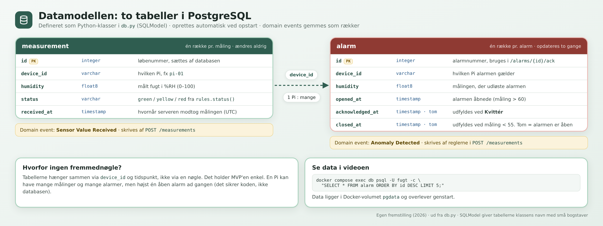{width=100%}

::: {custom-style="Billedtekst"}
(Diagram 3, egen fremstilling (2026): Databasens to tabeller, measurement (Sensor Value Received) og alarm (Anomaly Detected), med kolonner og betydning)
:::

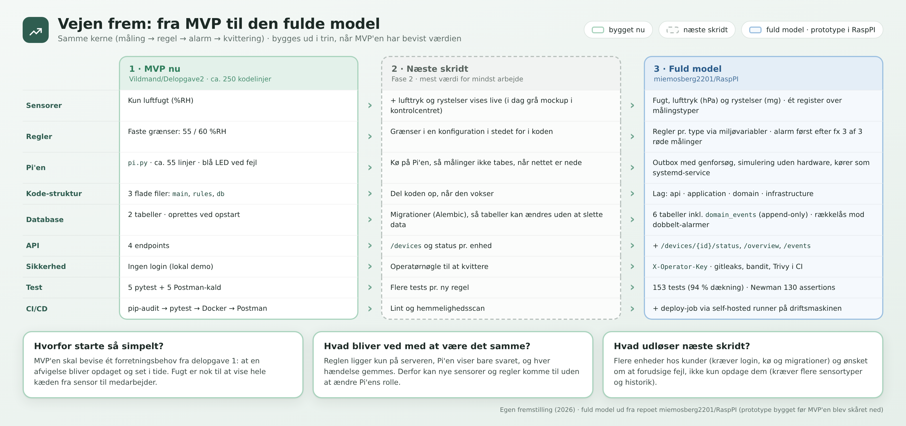{width=100%}

::: {custom-style="Billedtekst"}
(Diagram 4, egen fremstilling (2026): Vejen frem fra MVP'en nu over de næste skridt til den fulde model, som allerede er afprøvet i det første repository)
:::

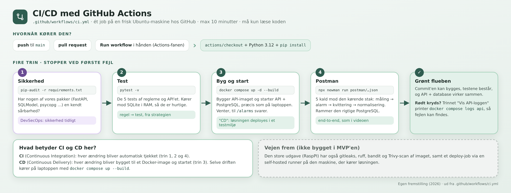{width=100%}

::: {custom-style="Billedtekst"}
(Diagram 5, egen fremstilling (2026): Den automatiske kontrol på GitHub Actions, fra ny kode til grønt flueben)
:::

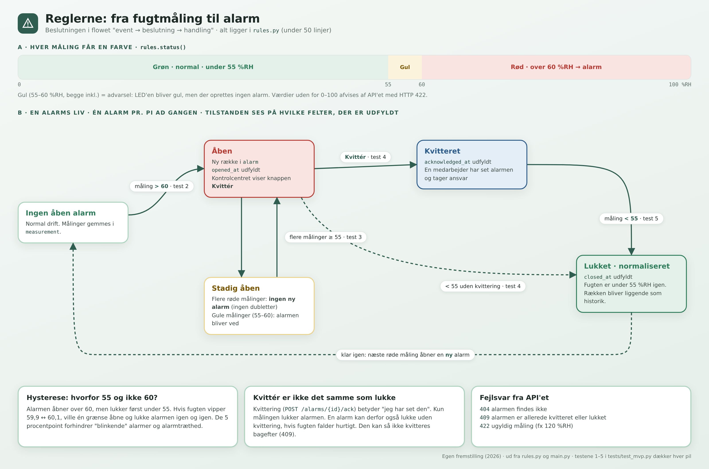{width=100%}

::: {custom-style="Billedtekst"}
(Diagram 6, egen fremstilling (2026): Reglerne og en alarms liv. Øverst farveskalaen med grænserne 55 og 60 %RH. Nederst en alarms forløb. Numrene på pilene er de tests, der kontrollerer hvert skridt)
:::

## Bilag C. Hele projektets mappestruktur på GitHub {.unnumbered .bilag}

Mappestrukturen (på engelsk et treeview) viser alle filer i https://github.com/Vildmand/Delopgave2. Kun tre filer udgør selve serveren: `main.py`, `rules.py` og `db.py`.

```
Delopgave2/
├── .github/
│   └── workflows/
│       └── ci.yml                CI/CD: pip-audit → pytest → Docker → Newman
├── docs/
│   ├── img/                      kodebilleder (01–11) og diagrammer (1–8)
│   ├── KODEGUIDE.md              forklaring af koden, fil for fil
│   ├── KRAV.md                   opgavens krav → hvor de er løst
│   ├── PI-GUIDE.md               sådan startes pi.py på Pi'en
│   ├── RAPPORT.md                denne rapport
│   ├── START-HER.md              overblik på én side til nye i gruppen
│   ├── VIDEOMANUSKRIPT.md        manuskript til videoen (ca. 5 min.)
│   └── praesentation.pdf/.pptx   gruppens præsentation
├── pi/
│   └── pi.py                     kører på Pi'en: måler, sender, farver LED
├── postman/
│   └── fugt-mvp.postman_collection.json   5 kald gennem alarmflowet
├── static/
│   └── index.html                kontrolcentret (HTML, CSS og JavaScript)
├── tests/
│   └── test_mvp.py               de 5 automatiske tests
├── .dockerignore                 filer, der ikke kommer med i containeren
├── .gitignore                    filer, git ikke skal gemme
├── Dockerfile                    opskriften på serverens container
├── README.md                     forsiden på GitHub: kom i gang og API
├── db.py                         databasen: measurement og alarm
├── docker-compose.yml            starter server og PostgreSQL
├── main.py                       REST API'et: de 4 endpoints
├── pytest.ini                    indstilling til testene
├── requirements-dev.txt          pakker kun til test
├── requirements.txt              pakker til serveren
└── rules.py                      reglerne: grøn/gul/rød, åbn og luk alarm
```

::: {custom-style="Billedtekst"}
(Bilag C, egen fremstilling (2026): Alle filer i projektets repository)
:::

## Bilag D. Begreber og forkortelser {.unnumbered .bilag}

De vigtigste fagord. Andre forkortelser er forklaret i en parentes, første gang de bruges.

| Begreb | Forklaring |
|-------|-----------------|
| API (Application Programming Interface) og endpoint | En fast indgang til et program, som andre programmer kan sende og hente data gennem, ligesom en skranke. Et endpoint er én adresse i API'et, for eksempel adressen /measurements, hvor Pi'en sender sine målinger hen. |
| REST (Representational State Transfer) | En udbredt måde at bygge et API på med internettets almindelige kommandoer GET ("hent") og POST ("send") (Fielding, 2000). |
| MVP (Minimum Viable Product) og microservice | MVP er den mindste udgave af et produkt, der virker og kan afprøves (Ries, 2011). En microservice er en lille, selvstændig webtjeneste, der løser én opgave. |
| Hændelse (på engelsk event) | En besked om noget, der allerede er sket, fx "måling modtaget" eller "alarm oprettet". |
| %RH og hysterese | %RH er relativ luftfugtighed i procent. Hysterese betyder, at alarmen starter over 60 %RH, men først slukker under 55 %RH, så den ikke blinker, når fugten vipper omkring 60. Det svarer til en termostat. |
| Docker og container | Docker pakker et program og alt, hvad det skal bruge, i en container, så det kører ens på alle computere. |
| DevSecOps og CI/CD | DevSecOps (Development, Security, Operations) er en arbejdsform, hvor udvikling, sikkerhed og drift hænger sammen. CI/CD (Continuous Integration / Continuous Delivery) er automatisk test, bygning og start af koden, hver gang den ændres. |

::: {custom-style="Billedtekst"}
(Bilag D, egen fremstilling (2026): Begreber og forkortelser)
:::
